# Flutter Week 6 — Authentication, Security & FCM

This repository demonstrates secure authentication flows, encrypted token storage with automatic refresh on 401, and Firebase Cloud Messaging (FCM) push notification handling across all three Android app states (foreground / background / terminated) in Flutter.

## Table of Contents

1. [Lab 1: Login + Secure Storage + Token Refresh](#1-lab-1-login--secure-storage--token-refresh)
2. [Lab 2: FCM, Permission & Token Lifecycle](#2-lab-2-fcm-permission--token-lifecycle)
3. [Lab 3: Payloads, Three App States, Clicks & Topics](#3-lab-3-payloads-three-app-states-clicks--topics)
4. [AI Challenge & Security Verification](#4-ai-challenge--security-verification)
5. [Refactoring, Testing, and Verification](#5-refactoring-testing-and-verification)
6. [Self-Verification Checklist](#6-self-verification-checklist)
7. [Reflection](#7-reflection)

---

## 1. Lab 1: Login + Secure Storage + Token Refresh

Implements an authentication flow where access and refresh tokens never leave `flutter_secure_storage` (Android Keystore / iOS Keychain), guarded by a GoRouter route guard.

### Project Setup

<!-- ```bash
flutter create campus_notify
cd campus_notify
flutter pub add flutter_riverpod go_router dio flutter_secure_storage
flutter pub add firebase_core firebase_messaging flutter_local_notifications
``` -->

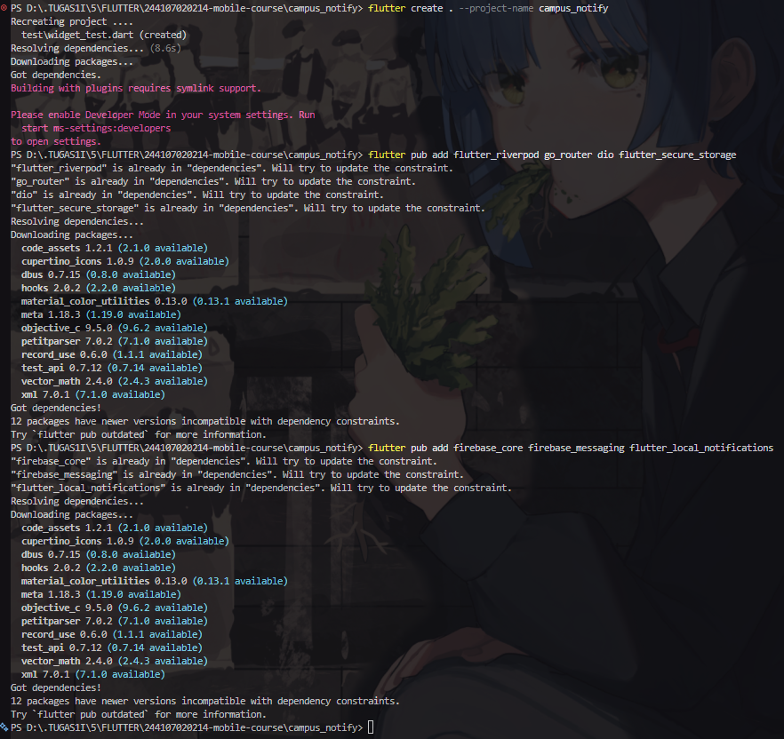

### Folder Structure

<!-- ```
lib/
├── main.dart
├── data/
│   ├── auth_repository.dart
│   ├── token_store.dart
│   └── api_client.dart
├── providers/
│   └── auth_provider.dart
├── messaging/
│   └── push_service.dart
└── pages/
    ├── login_page.dart
    ├── home_page.dart
    └── announcement_page.dart
``` -->

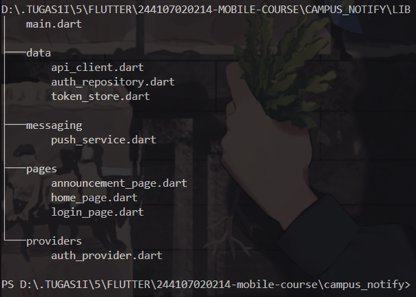

### Secure Token Storage

All tokens enter and leave the app only through `TokenStore` (`lib/data/token_store.dart`) — a single choke point wrapping `flutter_secure_storage` with `save()`, `readAccess()`, `readRefresh()`, and `clear()`. Tokens are **never** placed in `SharedPreferences`, logs, or full screenshots.

### Route Guard & Login Flow

Unauthenticated users are always redirected to `/login` via the GoRouter `redirect`, which listens to `authStateProvider`.

**Login page:**

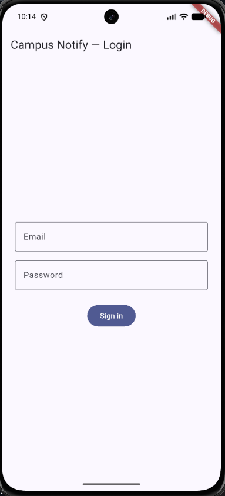

**Invalid credentials handling (mock repository rejects bad input):**

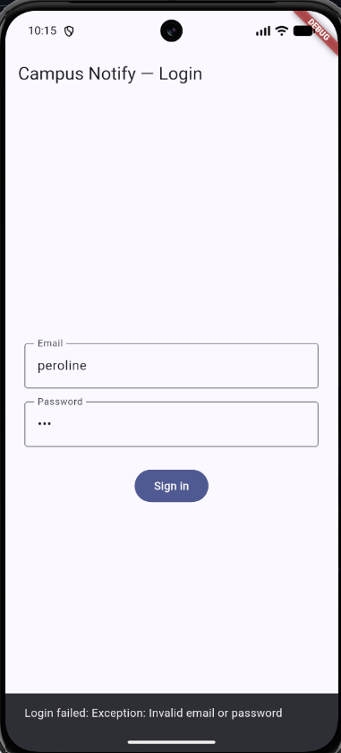

### Dio Auto-Refresh on 401

The `api_client.dart` interceptor attaches the access token on every request. On a `401` it:

1. Reads the refresh token from secure storage.
2. Performs **exactly one** refresh and replays the original request once.
3. Clears the session (`clear()`) and forces re-login when the refresh token is also dead.

---

## 2. Lab 2: FCM, Permission & Token Lifecycle

### Firebase Registration & Permission Prompt

`Firebase.initializeApp()` runs before `runApp`; Android 13+ / iOS runtime permission is requested via `requestPermission()`.

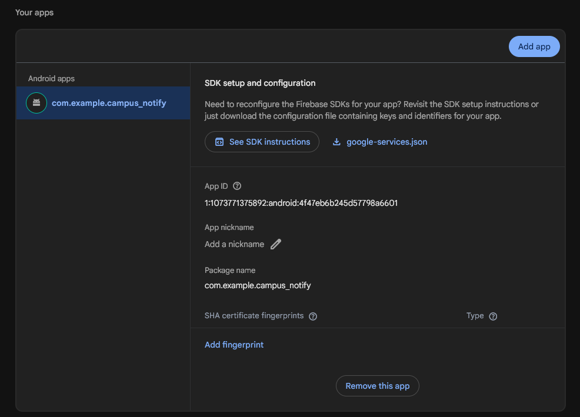

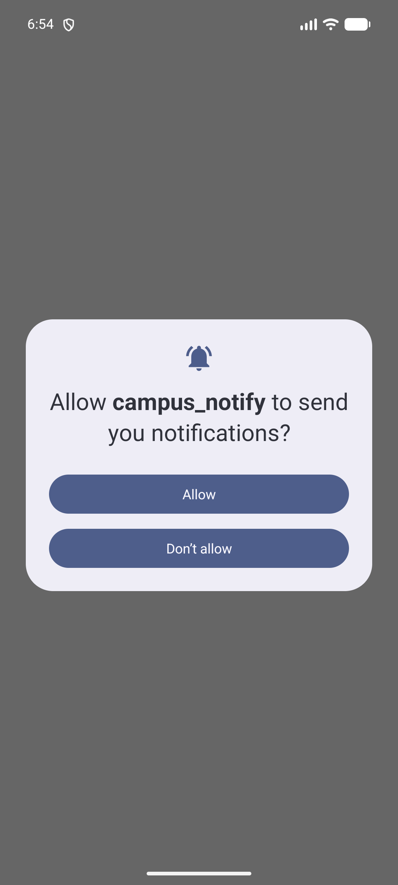

### Token Lifecycle (fetch → deliver → watch rotation)

- `getToken()` is fetched at startup and POSTed to the backend `/devices` endpoint.
- `onTokenRefresh` is registered as a **mandatory** listener — reinstall, data wipe, or security rotation otherwise leaves a stale token on the backend.
- The device subscribes to the `campus-announcement` topic for cohort broadcasts.

**Debug page showing the truncated token (first 12 characters + `...` — the full token is never displayed):**

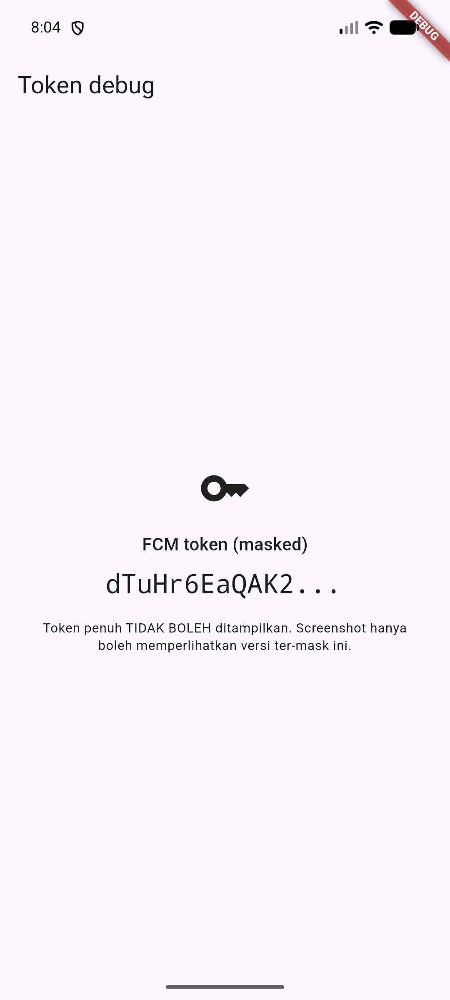

**First send test from the Firebase Console (app in background, system banner visible):**


---

## 3. Lab 3: Payloads, Three App States, Clicks & Topics

The backend always sends **combined notification + data** payloads: the system draws the banner automatically in background/terminated states, while `data.route` drives deep-link navigation in every state.

```json
{
  "message": {
    "topic": "campus-announcement",
    "notification": {
      "title": "Schedule changed",
      "body": "Mobile class moved to Room A2 at 1:00 PM"
    },
    "data": { "route": "/announcement/3", "id": "3" }
  }
}
```

### Three-State Test Matrix

| State          | Expected                                                                                                                | How to test                           | Evidence                                  |
| -------------- | ----------------------------------------------------------------------------------------------------------------------- | ------------------------------------- | ----------------------------------------- |
| **Foreground** | Local banner appears (shown manually via `flutter_local_notifications` in `onMessage`), tap routes to `/announcement/3` | App open, send from console/backend   | 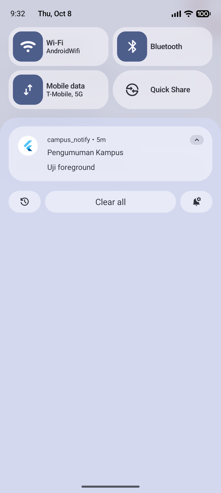 |
| **Background** | System banner appears, tap routes correctly                                                                             | Press Home, send, tap banner          | 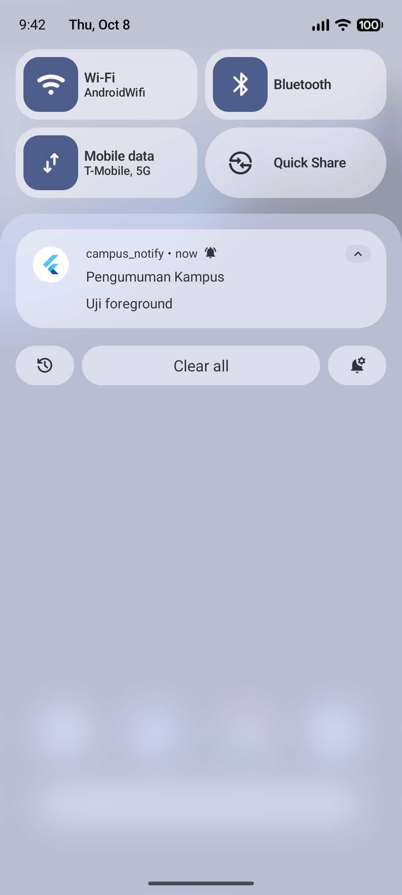 |
| **Terminated** | App opens to the right route via `getInitialMessage()`                                                                  | Swipe-close the app, send, tap banner |  |

**Deep-link destination page (`/announcement/:id`):**
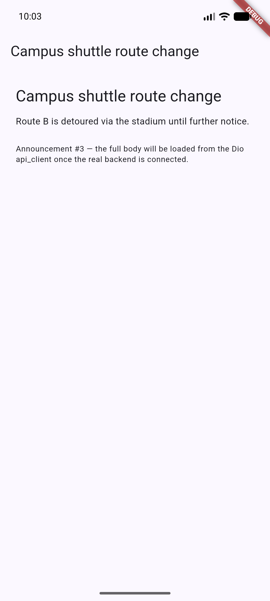

### Topic Messaging

`subscribeToTopic('campus-announcement')` / `unsubscribeFromTopic(...)` handle broadcasts (all students, one class, one club). Device tokens are reserved strictly for **personal** messages (grades, bills). The background handler is a top-level function marked `@pragma('vm:entry-point')` because it runs in a separate isolate and must never touch `BuildContext` or Riverpod.

---

## 4. AI Challenge & Security Verification

The AI prompt, the initial generated `PushService` draft, the manual fix list, and the three-state test table are archived in the `docs/` folder (`ai-prompt.md`, `ai-initial-output.md`, `manual-fixes.md`).

### AI Verification Checklist Findings

- **Background handler** — Verified as a **top-level function** with `@pragma('vm:entry-point')`; a class-method version would fail in the background isolate.
- **`onTokenRefresh` delivery** — Fixed: the AI draft only printed the new token to the log; it now POSTs to `/devices` so the backend never holds a stale token.
- **Foreground banner** — Confirmed: `onMessage` shows a manual local notification; without it, no banner appears while the app is open.
- **Three-state routing** — Proven with the test matrix above; taps from foreground, background, and terminated all land on the correct `/announcement/:id` route.
- **Secrets hygiene** — Confirmed: no hardcoded keys, tokens are never fully logged, and the debug page shows only a 12-character truncation.

### Final Decision

The AI scaffolding was accepted for boilerplate, with the token-refresh delivery fix and the top-level background handler enforced. All behavioral claims were proven by running the three-state matrix rather than trusting the generated code.

---

## 5. Refactoring, Testing, and Verification

### Refactoring

- All route strings (`/login`, `/announcement/:id`) centralized in `lib/routes.dart`, shared by GoRouter and FCM deep links.
- `RemoteMessage` → route parsing extracted into the pure function `routeFromMessage(Map<String, dynamic> data)` so it is unit-testable without Firebase.
- `DioException` → user-friendly message mapping (401, timeout, offline) moved into `lib/data/api_errors.dart`; the UI only receives messages, never raw exceptions.

### Flutter Test

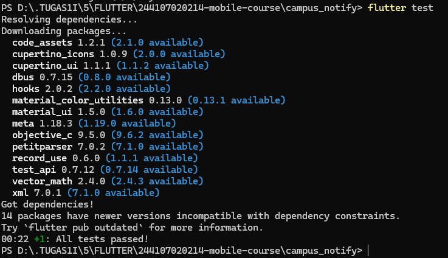

### Flutter Analyze

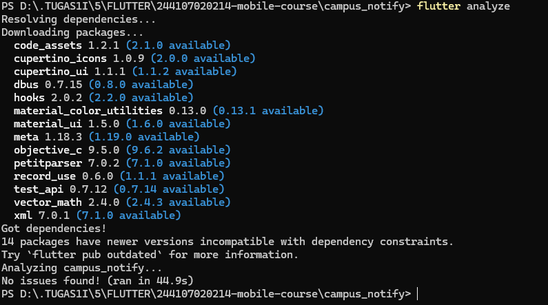

---

## 6. Self-Verification Checklist

| Checklist Item                    | Status  | Verification Notes                                                                                                            |
| --------------------------------- | ------- | ----------------------------------------------------------------------------------------------------------------------------- |
| **Tokens only in secure storage** | ✅ Pass | Access/refresh tokens live exclusively in `flutter_secure_storage` — never in `SharedPreferences`, logs, or full screenshots. |
| **401 refresh policy**            | ✅ Pass | Exactly one refresh + one replay per 401; a dead refresh token calls `clear()` and routes to `/login`.                        |
| **Three app states tested**       | ✅ Pass | Foreground / background / terminated evidence captured; all taps land on the correct `/announcement/:id` route.               |
| **Topic vs device token**         | ✅ Pass | `campus-announcement` topic for broadcasts; device token reserved for personal messages.                                      |
| **Code Quality & Test Suite**     | ✅ Pass | `flutter analyze` returns 0 issues; route-parsing and session/refresh unit tests pass in `test/auth_push_test.dart`.          |
| **AI Output Documentation**       | ✅ Pass | Prompt, initial output, manual fixes, and technical rationale documented in `docs/`.                                          |

---

## 7. Reflection

### 1. Why must refresh tokens never live in `SharedPreferences`? What is the risk if one leaks?

`SharedPreferences` is stored as plaintext XML on Android (and plist on iOS) — unencrypted, world-readable within the device image, and included in unencrypted backups. If a refresh token leaks, an attacker can mint brand-new access tokens indefinitely without ever knowing the password — a silent, persistent account takeover that survives password changes until the refresh token itself is revoked server-side. `flutter_secure_storage` avoids this by delegating to the hardware-backed Android Keystore / iOS Keychain.

### 2. What breaks if `onTokenRefresh` is ignored for a whole semester?

The backend keeps a stale FCM token after any reinstall, data wipe, or token rotation. The student silently stops receiving every campus announcement (schedule changes, exam notices, closures) with no visible error anywhere — push simply stops working. Orphaned tokens also accumulate in the devices table, wasting send quota and polluting delivery analytics.

### 3. When do you use a topic vs a device token? Give one campus example for each.

- **Topic** — one-to-many broadcasts with no per-user targeting: `campus-announcement` for "Mobile class moved to Room A2 at 1:00 PM" sent to every subscriber.
- **Device token** — strictly personal, per-identity messages: "Your SPP tuition bill for this month is due" or a grade-release notice, delivered only to that one student's registered token.

### 4. Which part of the AI draft did you reject or fix, and why?

- **Rejected/Fixed** — the AI's `onTokenRefresh` listener only printed the rotated token to the console instead of POSTing it to `/devices`, which would reproduce exactly the stale-token failure described above.
- **Also enforced** — the background handler was moved out of a class into a top-level function with `@pragma('vm:entry-point')`, and the debug page was changed to render a truncated token. Reading code alone cannot prove push behavior, so every fix was validated against the three-state test matrix before being accepted.
