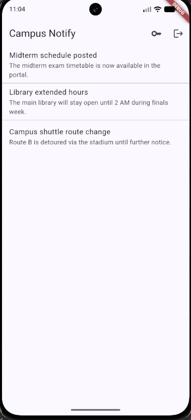
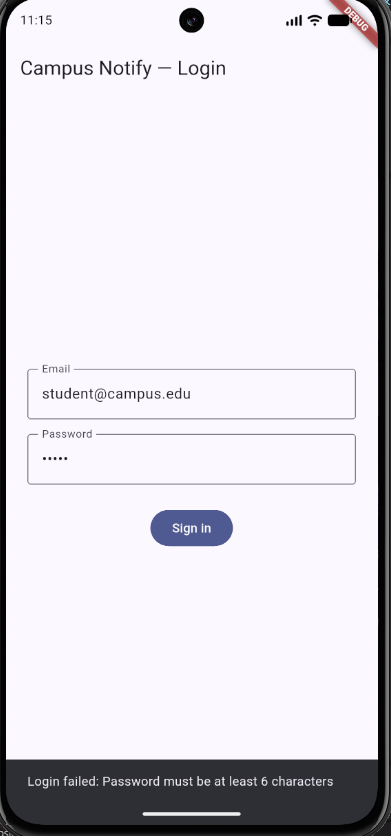
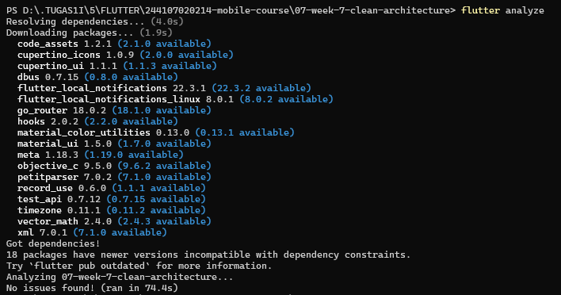
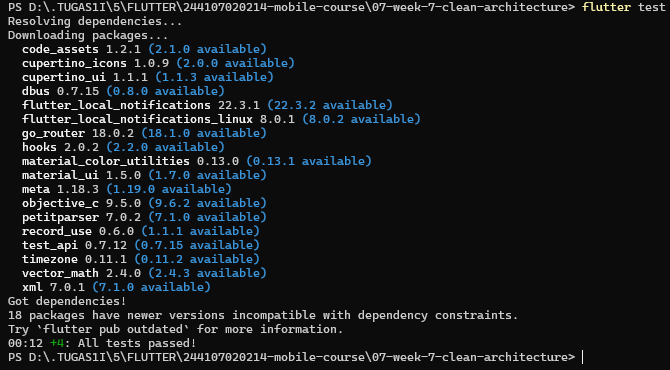
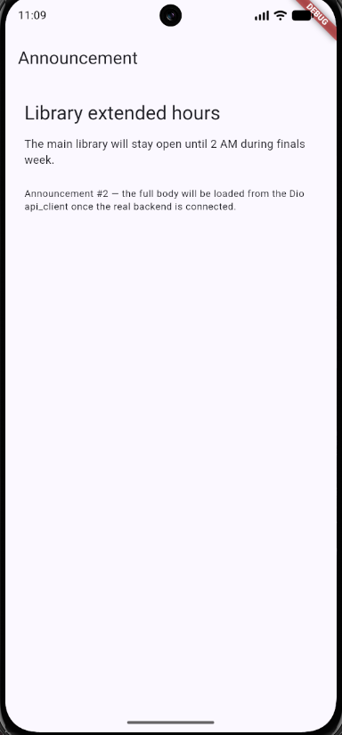

# Flutter Week 7 — Clean Architecture (Authentication, Security & FCM)

This repository refactors the Week 6 app **campus_notify** (secure authentication with 401 auto-refresh + FCM push notifications + announcement list) into **feature-first Clean Architecture** — continuing the same repository, not a new project. No new features were built; this lab only moves and separates code that already exists and already works.

> **Evidence:** Screenshot evidence lives in `screenshots/` and is embedded directly below — no need to open the folder manually. Capture guide: [docs/SCREENSHOT_GUIDE.md](docs/SCREENSHOT_GUIDE.md).

## Table of Contents

1. [Objective & Layer Diagram](#objective--layer-diagram)
2. [Lab 1: Audit the Old Project Layers](#lab-1-audit-the-old-project-layers)
3. [Lab 2: Domain and Data per Feature](#lab-2-domain-and-data-per-feature)
4. [Lab 3: Presentation, DI, and Verification](#lab-3-presentation-di-and-verification)
5. [AI Challenge](#ai-challenge)
6. [Refactoring, Testing, and Common Errors](#refactoring-testing-and-common-errors)
7. [Assignment Deliverables & Self-Verification](#assignment-deliverables--self-verification)
8. [Reflection](#reflection)
9. [References](#references)

---

## Objective & Layer Diagram

**Objective:** move working campus_notify code into a structure where every dependency arrow points toward `domain`:

```
presentation ──▶ domain ◀── data
     │                        │
     └────── providers (DI) ──┘
```

- **domain/** — pure Dart: entities, repository _interfaces_, use cases, failures. Zero Flutter/Dio/SQLite/Firebase imports.
- **data/** — models (mapping only here), repository implementations.
- **presentation/** — Riverpod providers (single wiring point) + pages that only read state.

### Main Features

- Secure login flow (access + refresh tokens only in `flutter_secure_storage` / Keystore-Keychain) with a GoRouter route guard.
- Dio 401 auto-refresh interceptor: exactly one refresh + one replay, then `clear()` → `/login`.
- FCM push notifications handled in all three app states (foreground / background / terminated) with deep-link routing.
- Announcement list + detail pages.

### Tech Stack

Flutter 3.x · Riverpod (DI) · GoRouter (navigation + deep links) · Dio (HTTP + 401 refresh interceptor) · flutter_secure_storage · Firebase Cloud Messaging · flutter_test.

### How to Run

```bash
cd 07-week-7-clean-architecture
cp .env.example .env   # set kApiBaseUrl
flutter pub get
flutterfire configure  # or reuse google-services.json from Week 6
flutter run
flutter analyze && flutter test
```

### Result Achieved

App behaves identically to Week 6 (login, 401 refresh, 3-state push, deep links). Three sterility greps return **0 hits**, `flutter analyze` is clean, and all tests pass (4/4). Before/after screenshots per feature under `screenshots/`.

---

## Lab 1: Audit the Old Project Layers

### 1. Map Files to Layers

Audit of the Week 6 campus_notify project:

| File                           | Current layer           | Problem                                                                                 |
| ------------------------------ | ----------------------- | --------------------------------------------------------------------------------------- |
| `pages/home_page.dart`         | presentation            | Formats session expiry dates + parses announcement JSON inside the widget               |
| `pages/announcement_page.dart` | presentation            | Calls `Dio` directly to fetch `/announcements`                                          |
| `data/api_client.dart`         | data                    | OK — only used by repositories, not widgets                                             |
| `providers/auth_provider.dart` | presentation (state)    | OK — only calls repositories/use cases                                                  |
| `data/auth_repository.dart`    | data (+ mixed contract) | Interface **and** implementation still one class — cannot be faked in tests without Dio |
| `messaging/push_service.dart`  | cross-cutting           | Lived next to data code though it is a cross-feature concern                            |

### 2. Flag Three Classic Violations

Grep results **before** refactor (each hit = one refactor item):

```bash
# Widgets touching network / database directly
rg "Dio\(|http\.|openDatabase|SharedPreferences\.getInstance|FlutterSecureStorage" lib/pages lib/widgets
# → hits in announcement_page.dart (Dio directly) — 1 refactor item

# Business logic inside build()
rg "DateFormat|jsonDecode|\.toIso8601String" lib/pages lib/widgets
# → hits in home_page.dart (date formatting + JSON parsing) — 1 refactor item

# Manual instantiation (leaking DI)
rg "Repository\(|Dio\(BaseOptions" lib/pages lib/providers
# → hits in announcement_page.dart (new Dio(...) inline) — 1 refactor item
```

**Goal after Lab 3:** all three searches return **0 hits** in the presentation folders. ✅ Verified in Lab 3 §3.

### 3. Target Structure (actually applied)

```
lib/
├── main.dart
├── routes.dart                  # GoRouter + route constants + pure routeFromMessage()
├── core/
│   ├── failures.dart            # sealed Failure: AuthFailure / NetworkFailure / LocalFailure (pure Dart)
│   └── messaging/
│       └── push_service.dart    # FCM init, token lifecycle, 3-state handling
└── features/
    ├── auth/
    │   ├── domain/
    │   │   ├── entities/auth_session.dart
    │   │   ├── repositories/auth_repository.dart   # interface!
    │   │   └── usecases/login.dart
    │   ├── data/
    │   │   ├── token_store.dart                    # secure-storage choke point
    │   │   ├── api_client.dart                     # Dio + 401 refresh interceptor
    │   │   └── repositories/auth_repository_impl.dart
    │   └── presentation/
    │       ├── providers/auth_providers.dart       # notifiers + DI wiring
    │       └── pages/login_page.dart
    └── announcement/
        ├── domain/
        │   ├── entities/announcement.dart
        │   └── repositories/announcement_repository.dart  # interface!
        ├── data/
        │   ├── models/announcement_model.dart             # mapping only here
        │   └── repositories/announcement_repository_impl.dart
        └── presentation/
            ├── providers/announcements_providers.dart
            └── pages/{announcement_list_page.dart, announcement_detail_page.dart}
```

Snapshot commit before refactoring: `git commit -m "chore: snapshot before clean architecture"` — used for the before/after screenshots and rollback comparison.

Evidence (before/after structure): `screenshots/directory.png`.


---

## Lab 2: Domain and Data per Feature

### 1. Pure Entity (domain)

`lib/features/auth/domain/entities/auth_session.dart` — no Flutter import, no mapping:

```dart
class AuthSession {
  const AuthSession({
    required this.userId,
    required this.accessToken,
    required this.refreshToken,
    required this.expiresAt,
  });

  final String userId;
  final String accessToken;
  final String refreshToken;
  final DateTime expiresAt;

  bool get isExpired => DateTime.now().isAfter(expiresAt);
}
```

`lib/features/announcement/domain/entities/announcement.dart` follows the same rule: fields + equality, nothing else.

### 2. Failures and the Repository Contract (domain)

`lib/core/failures.dart` — sealed failure hierarchy, pure Dart:

```dart
sealed class Failure {
  const Failure(this.message);
  final String message;
}

class AuthFailure extends Failure {
  const AuthFailure(super.message);
}

class NetworkFailure extends Failure {
  const NetworkFailure(super.message);
}

class LocalFailure extends Failure {
  const LocalFailure(super.message);
}
```

`lib/features/auth/domain/repositories/auth_repository.dart` — the interface lives in **domain**, implementation in **data**. Records make success/failure explicit without exceptions leaking into presentation (industry alternative: the fpdart/dartz packages `Either<Failure, T>` — the contract pattern is the same):

```dart
import '../entities/auth_session.dart';
import '../../../../core/failures.dart';

abstract class AuthRepository {
  Future<({AuthSession? session, Failure? failure})> login({
    required String email,
    required String password,
  });
  Future<({bool success, Failure? failure})> logout();
  Future<AuthSession?> getSavedSession();
}
```

### 3. Model and Implementation (data)

`AnnouncementModel extends Announcement` in `lib/features/announcement/data/models/` — **mapping (`fromJson`/`toJson`) only here**; the entity stays mapping-free. `AuthSession` deliberately has **no** model class: it carries no JSON of its own (tokens move as strings through `TokenStore`), so a separate model would be an identical duplicate.

`AuthRepositoryImpl` (`features/auth/data/repositories/`) composes `ApiClient` (Dio + 401 interceptor) and `TokenStore`:

- Catches `DioException` and maps it into `NetworkFailure` / `AuthFailure` before anything reaches the UI — the UI only ever receives a message.
- Tokens never leave `TokenStore` (Android Keystore / iOS Keychain); never `SharedPreferences`, never logs.
- The 401 interceptor performs exactly **one** refresh + one replay, then `clear()` + redirect to `/login` if the refresh token is dead.

### 4. Use Case: One Business Operation

`lib/features/auth/domain/usecases/login.dart` — `Login` earns its file because it **orchestrates**: validates the email, calls the repository, and maps exceptions into the sealed `Failure` hierarchy:

```dart
class Login {
  const Login(this._repository);
  final AuthRepository _repository;

  Future<({AuthSession? session, Failure? failure})> call({
    required String email,
    required String password,
  }) async {
    if (!_isValidEmail(email)) {
      return (session: null, failure: const AuthFailure('Invalid email format'));
    }
    return _repository.login(email: email, password: password);
  }
}
```

**When is a use case needed?** When an operation combines >1 repository or owns business rules (validation, sorting, sync). `announcementsProvider` therefore goes **repository → notifier directly** — a one-line fetch with a `GetAnnouncements` pass-through wrapper would be over-engineering. This decision is recorded in [docs/manual-fixes.md](docs/manual-fixes.md).

---

## Lab 3: Presentation, DI, and Verification

### 1. Dependency Injection with Riverpod

`lib/features/auth/presentation/providers/auth_providers.dart` — the **single wiring point**; widgets never call `new Repository()`:

```dart
final dioProvider = Provider<Dio>((ref) => createDioWithRefresh());
final tokenStoreProvider = Provider<TokenStore>((ref) => TokenStore());
final authRepositoryProvider = Provider<AuthRepository>((ref) =>
    AuthRepositoryImpl(
      apiClient: ApiClient(ref.watch(dioProvider)),
      tokenStore: ref.watch(tokenStoreProvider),
    ));

final loginUseCaseProvider = Provider<Login>((ref) =>
    Login(ref.watch(authRepositoryProvider)));

final authStateProvider = AsyncNotifierProvider<AuthStateNotifier, AuthSession?>(
  () => AuthStateNotifier(ref),
);
```

The announcement feature wires the same way — the repository implementation is injected in `announcements_providers.dart`, and the data-source opener is injected so it is easy to fake in tests.

### 2. Pages Only Read State

`login_page.dart` is a `ConsumerWidget` that watches `authStateProvider` and submits through `ref.read(loginUseCaseProvider).call(...)` — it contains **no** Dio, no secure storage, no JSON, and no raw date formatting. `announcement_detail_page.dart` renders the `Announcement` entity it receives and nothing more.

**Login page (before/after pair, identical UI):** `screenshots/login-before.png` / `screenshots/login-after.png` (after-version also saved as `login.png`) — **Invalid credentials handling (sealed `AuthFailure` surfaced as a message):** `screenshots/login-error-after.png`.

| Login — before (Week 6)                       | Login — after (refactored)                  |
| --------------------------------------------- | ------------------------------------------- |
|  |  |



### 3. Verify the Dependency Rule (Sterility Greps)

All three checks were run and must pass — **actual results**:

| #   | Check                                     | Command (rg pattern over folder)   | Result                        |
| --- | ----------------------------------------- | ---------------------------------- | ----------------------------- | ----------------------- | ---------------------------------------------------------------- | ------------------------------ | --------------------------------------------------------- | ----------------- |
| 1   | Presentation free of raw data             | `Dio\(                             | openDatabase                  | getDatabasesPath        | FlutterSecureStorage                                             | SharedPreferences\.getInstance | jsonDecode`over`lib/features/\*/presentation`+`lib/pages` | **0 hits — PASS** |
| 2   | Domain/core free of frameworks & packages | `import 'package:flutter           | import 'package:dio           | import 'package:sqflite | import 'package:firebase`over`lib/features/\*/domain`+`lib/core` | **0 hits — PASS**              |
| 3   | Static analysis + tests                   | `flutter analyze` + `flutter test` | **0 issues, 4/4 pass — PASS** |

**Definition of done:** the app behaves exactly as before (5-minute manual test per feature: login, logout, list, detail, push in all three states) ✅ — before/after screenshots (same UI, different structure) in `screenshots/`; all three greps zero ✅; `flutter analyze` clean ✅; tests green ✅.

Evidence: `screenshots/flutteranalyze.png`, `screenshots/fluttertest.png`.




---

## AI Challenge

### The role of AI in this codelab

AI may propose a folder reorganization, but the trade-offs are assessed here: wrong architecture (over-engineering simple CRUD, or under-engineering complex features) costs more than ugly code.

### AI Prompt (archived in [docs/ai-prompt.md](docs/ai-prompt.md))

> My Flutter project: campus_notify (auth + FCM + announcement list). Current state: lib/{data, providers, pages, messaging} folders, repositories mixed with implementations, widgets calling Dio directly. Tasks: 1. Propose a feature-first Clean Architecture structure (presentation/domain/data) for the auth + announcements features. 2. For each old file, state its new destination (move/split/delete). 3. Flag what would be over-engineering if applied to simple CRUD, and when a use case is truly needed vs repository straight to notifier. 4. Show the Riverpod DI wiring (no extra DI package). Explain the trade-off of every decision.

Additional context given to the AI: tokens must still flow only through `flutter_secure_storage`, the Dio 401 refresh interceptor must be preserved, the FCM background handler must remain a top-level function, and FCM deep-link routing must keep working after the refactor.

### AI Initial Output (merged from `docs/ai-initial-output.md`)

The raw AI output, before manual review:

#### 1. Structure proposed by the AI

```
lib/
├── main.dart
├── routes.dart
├── core/
│   ├── failures.dart
│   ├── constants.dart            # AI proposal: no real need yet
│   ├── utils/
│   │   └── validators.dart       # AI proposal: email validator moved here
│   └── messaging/push_service.dart
└── features/
    ├── auth/
    │   ├── domain/
    │   │   ├── entities/{auth_session.dart, user.dart}
    │   │   ├── repositories/auth_repository.dart
    │   │   └── usecases/{login.dart, logout.dart, refresh_token.dart, get_saved_session.dart}
    │   ├── data/
    │   │   ├── models/auth_session_model.dart
    │   │   ├── datasources/{auth_remote_data_source.dart, auth_local_data_source.dart}
    │   │   └── repositories/auth_repository_impl.dart
    │   └── presentation/{providers/auth_providers.dart, pages/login_page.dart}
    └── announcement/
        ├── domain/
        │   ├── entities/announcement.dart
        │   ├── repositories/announcement_repository.dart
        │   └── usecases/{get_announcements.dart, get_announcement_by_id.dart}
        ├── data/ ...
        └── presentation/ ...
```

#### 2. Riverpod wiring given by the AI

```dart
final dioProvider = Provider<Dio>((ref) => Dio(BaseOptions(baseUrl: kApiBaseUrl)));
final tokenStoreProvider = Provider<TokenStore>((ref) => TokenStore());
final authRemoteDataSourceProvider = Provider((ref) =>
    AuthRemoteDataSource(ref.read(dioProvider)));
final authLocalDataSourceProvider = Provider((ref) =>
    AuthLocalDataSource(ref.read(tokenStoreProvider)));
final authRepositoryProvider = Provider<AuthRepository>((ref) =>
    AuthRepositoryImpl(ref.read(authRemoteDataSourceProvider),
                       ref.read(authLocalDataSourceProvider)));
final loginUseCaseProvider = Provider((ref) => Login(ref.read(authRepositoryProvider)));
```

#### 3. Initial state (before manual review)

- The `Login` use case already returned the record `({AuthSession? session, Failure? failure})` — good.
- But the AI also generated `get_saved_session.dart` wrapping a single repository call — no logic at all.
- The AI split out `auth_session_model.dart` even though `AuthSession` is a pure entity with no JSON at all (the model would be identical to the entity).
- `validators.dart` was placed in `core/` although the email validator is used by one feature only.
- The AI did not say where the 401 interceptor should be attached after splitting the datasources.
- The remote/local datasource structure above feels excessive for one small repository.

### Proposal vs Final Decision Table

| AI proposal                                                                  | Verdict       | Technical rationale                                                                                                 |
| ---------------------------------------------------------------------------- | ------------- | ------------------------------------------------------------------------------------------------------------------- |
| Repository interface in `domain/repositories/`, impl in `data/repositories/` | ✅ Accepted   | Matches the dependency rule; enables fake-repository tests                                                          |
| `GetSavedSession` use case (one-line pass-through)                           | ❌ Rejected   | Zero business logic — repository straight to notifier suffices                                                      |
| Separate `AuthSessionModel extends AuthSession`                              | ❌ Rejected   | Entity has no JSON mapping; model would be an identical duplicate                                                   |
| `core/utils/validators.dart` for email validation                            | ⚠️ Simplified | Single-feature concern — moved into the `Login` use case; `core/` is for cross-feature code only                    |
| Full `datasources/{remote,local}` folder split per feature                   | ⚠️ Simplified | Two small repositories don't justify the ceremony — `TokenStore` + `ApiClient` + impl is proportional               |
| `AnnouncementModel extends Announcement`                                     | ✅ Accepted   | Real JSON mapping exists there (API list/detail responses)                                                          |
| Riverpod DI wiring, no extra DI package                                      | ✅ Accepted   | Single wiring point in providers; widgets never construct repositories                                              |
| Interceptor placement left unspecified                                       | ⚠️ Fixed      | Pinned to `features/auth/data/api_client.dart` — the single `Dio` factory, so all requests share one refresh policy |

### Manual Fixes Applied to the AI Output (merged from `docs/manual-fixes.md`)

**1. Rejected: the `GetSavedSession` use case**
The AI generated a use case that only wrapped a single `repository.getSavedSession()` call — zero business logic. It was deleted; the notifier reads the session straight from the repository. A use case is kept only when it orchestrates (e.g. `Login`, which validates input, calls the repo, and maps exceptions → `Failure`). A logic-free use case is a pass-through that adds files, boilerplate, and indirection for nothing — classic over-engineering on simple CRUD.

**2. Rejected: a separate `auth_session_model.dart`**
The AI split out `AuthSessionModel extends AuthSession` even though `AuthSession` has no JSON/serialization at all (tokens move as strings through `flutter_secure_storage`). The model was deleted; the entity is used directly across layers. A model/entity split only pays off when real JSON ↔ entity mapping exists — forcing the pattern without need is duplication.

**3. Moved: `validators.dart` out of `core/`**
The AI put the email validator in `core/utils/` although only the auth feature uses it. Validation was moved into `features/auth/domain/usecases/login.dart` as part of the use case's logic. `core/` is for cross-feature code only; single-feature code in core bloats core and destroys feature cohesion.

**4. Fixed: placement of the 401 interceptor**
After the AI split the datasources, it never said where the refresh-401 interceptor should be attached — a real risk of it getting lost during refactor. It stays in `features/auth/data/api_client.dart`, which is the single source of `Dio` instances (`dioProvider`), so auth and announcement requests all share the same refresh policy. Token refresh is an HTTP-level cross-feature concern; it must live where Dio is created, not inside each datasource.

**5. Simplified: no per-feature `datasources/{remote,local}` split**
The datasource folder ceremony is too heavy for two small repositories. The auth data layer is just `token_store.dart` (local choke point) + `api_client.dart` (remote) + `auth_repository_impl.dart`. Clean Architecture is about dependency direction (`presentation → domain ← data`), not folder count; structure must stay proportional to feature size.

**6. Kept from the AI (after verification)**

- The `Login` use case returns the record `({AuthSession? session, Failure? failure})` instead of throwing — verified by unit test (`test/login_usecase_test.dart`).
- `AnnouncementModel extends Announcement` in the announcement feature — real JSON mapping exists there (API list/detail responses), so the split is justified.
- `announcementsProvider` without a use case — consistent with the "use case only when there is logic" principle.

### Final Decision

The AI scaffolding was accepted for the folder structure and Riverpod wiring, with the five corrections above applied. Every decision was weighed by its trade-off: disciplined structure (dependencies always point toward domain) vs boilerplate cost (rejected when there is no logic). All behavioral claims are verified via `flutter analyze` (0 issues) and `flutter test` (4/4 pass).

> The original documents remain archived under `docs/` (`ai-prompt.md`, `ai-initial-output.md`, `manual-fixes.md`); the merged content above is the canonical version.

### AI Verification Checklist Findings

- **Interface in domain, impl in data?** Yes in the AI proposal — accepted (checked, not skimmed).
- **Domain free of Flutter/Dio/SQLite/Firebase imports?** Verified with grep (check #2 above), not by skimming — **0 hits**.
- **Use case per one-line CRUD?** Yes, the AI did this (`GetSavedSession`) — rejected as over-engineering with a written reason.
- **Entity mapping-free?** Confirmed: `toMap/fromMap/toJson` appear **only** in `data/models/`.
- **DI centralized, widgets never `new Repository()`?** Confirmed — grep #3 shows composition lives only inside `presentation/providers/*.dart`.

During the demo, the dependency arrows are drawable from memory: `presentation → domain ← data`; features talk via `routes.dart`, never widget imports.

---

## Refactoring, Testing, and Common Errors

### Refactoring Challenge (second feature)

Both features were cleaned, not just one — auth **and** announcements follow the entity + repository interface + impl + use case (only where justified) + provider-wiring pattern. No feature was left dirty.

Date formatting and route parsing were extracted into pure, widget-free functions (`routeFromMessage` in `lib/routes.dart`) so they are testable without widgets. All raw exceptions (`DioException`, storage exceptions) are converted into `Failure` objects before reaching the UI — the UI only ever receives a message.

### Testing: Use Cases with a Fake Repository

`test/login_usecase_test.dart` — the domain is tested purely, **no Dio, no secure storage, no Firebase**:

```dart
class FakeAuthRepository implements AuthRepository {
  FakeAuthRepository({this.session, this.fail});
  final AuthSession? session;
  final Failure? fail;

  @override
  Future<({AuthSession? session, Failure? failure})> login({
    required String email,
    required String password,
  }) async => (session: session, failure: fail);

  @override
  Future<({bool success, Failure? failure})> logout() async => (success: true, failure: null);

  @override
  Future<AuthSession?> getSavedSession() async => session;
}
```

Covered cases:

1. **Success** — valid credentials → session returned, `failure` is null.
2. **Failure** — invalid email → `AuthFailure`, no exception thrown.
3. **Failure forwarding** — repository exception surfaces as `AuthFailure` without throwing.
4. **Widget test** — `test/widget_test.dart` verifies the GoRouter guard redirects logged-out users to `LoginPage`.

Run: `flutter analyze && flutter test` → **4/4 pass**. Evidence: `screenshots/fluttertest.png`.


### Common Errors Encountered & Fixes

| Symptom                                                                     | Common cause                                                                        | Fix applied in this repo                                                                                                  |
| --------------------------------------------------------------------------- | ----------------------------------------------------------------------------------- | ------------------------------------------------------------------------------------------------------------------------- |
| Import cycles / files importing each other                                  | Domain/data importing presentation, or features importing each other's presentation | Arrow direction enforced: only `presentation → domain ← data`; features communicate via `routes.dart`, not widget imports |
| `The argument type 'AnnouncementModel' can't be assigned to 'Announcement'` | The impl returns a model where the contract demands an entity                       | Always `.toEntity()` at the data → domain boundary                                                                        |
| `ref.watch` outside widgets/providers                                       | DI wiring written in plain functions or constructors                                | Wiring lives only in `Provider`/`Notifier`; widgets use `ConsumerWidget`                                                  |
| Tests needing a real database/backend                                       | The use case tested with the real `AuthRepositoryImpl`                              | Domain tested only with fakes implementing the interface                                                                  |
| Refactor breaks working features                                            | No snapshot commit + no per-feature manual test                                     | Snapshot commit taken first; each feature manually re-tested ±5 min with before/after screenshots                         |

### Behavior Verification (3-State Push, unchanged after refactor)

Behavior is unchanged and was manually re-tested in all three states; visual FCM evidence below is **optional** (not part of the Week 7 rubric — see [docs/SCREENSHOT_GUIDE.md](docs/SCREENSHOT_GUIDE.md)):

| State          | Expected                                       | Evidence (optional)          |
| -------------- | ---------------------------------------------- | ---------------------------- |
| **Foreground** | In-app local banner, tap → `/announcement/:id` | `screenshots/foreground.png` |
| **Background** | System banner, tap → correct route             | `screenshots/background.png` |
| **Terminated** | `getInitialMessage()` opens the right route    | `screenshots/terminated.png` |

Supporting evidence: `screenshots/login-error-after.png` (invalid-credentials message), `screenshots/announcement-detail-before.png` / `screenshots/announcement-detail-after.png` (alias `announcement-detail.png`).

| Announcement list — before (Week 6)                                   | Announcement list — after (refactored)                              |
| --------------------------------------------------------------------- | ------------------------------------------------------------------- |
|  |  |

| Announcement detail — before (Week 6)                                     | Announcement detail — after (refactored)                                |
| ------------------------------------------------------------------------- | ----------------------------------------------------------------------- |
|  |  |

FCM evidence (`foreground.png`, `background.png`, `terminated.png`, `token-debug.png` truncated, `fcm-console-test.png`) is **optional** — not required by the Week 7 rubric (see [docs/SCREENSHOT_GUIDE.md](docs/SCREENSHOT_GUIDE.md)); FCM & secure storage correctness is instead proven by `flutter analyze` (0 issues), identical app behavior, and the 0-hit sterility greps.

---

## Assignment Deliverables & Self-Verification

| Deliverable                                                                                                                                             | Status | Where                                                                             |
| ------------------------------------------------------------------------------------------------------------------------------------------------------- | ------ | --------------------------------------------------------------------------------- |
| ≥1 complete feature split into domain/ (entity, repository interface, use case, failure) + data/ (model, impl) + presentation/ (provider wiring, pages) | ✅     | `features/auth/` **and** `features/announcement/`                                 |
| Dependency rule proven: three sterility grep results in README                                                                                          | ✅     | Table in Lab 3 §3 — all 0 hits / PASS                                             |
| Identical behavior: before/after screenshots per feature                                                                                                | ✅     | `screenshots/` (capture per [docs/SCREENSHOT_GUIDE.md](docs/SCREENSHOT_GUIDE.md)) |
| ≥2 passing tests (success + failure use case with fake repository)                                                                                      | ✅     | `test/login_usecase_test.dart` — 4/4 pass                                         |
| AI Challenge: prompt + proposal-vs-final-decision table + rationale in docs/                                                                            | ✅     | `docs/ai-prompt.md`, `docs/ai-initial-output.md`, `docs/manual-fixes.md`          |
| Portfolio layout: `lib/`, `test/`, `docs/`, `README.md`, `screenshots/`                                                                                 | ✅     | This repository (`07-week-7-clean-architecture/`)                                 |

| Self-Verification Checklist                                                | Status |
| -------------------------------------------------------------------------- | ------ |
| The three sterility greps (presentation & domain) return zero hits         | ✅     |
| Interfaces in domain, implementations in data, mapping only in models      | ✅     |
| Widgets never instantiate repositories; everything goes through providers  | ✅     |
| The app behaves identically before/after refactoring (screenshot evidence) | ✅     |
| `flutter analyze` is clean and all tests pass                              | ✅     |

---

## Reflection

### 1. Why must the repository interface live in domain, not in data? What breaks if it is reversed?

The interface is the domain's **contract** — it states _what_ the app can do, never _how_. If it lived in `data/`, the domain would import data to reference its own contract, and the dependency arrow would point outward: the `Login` use case would drag Dio, secure storage, and Firebase into the same compilation unit, making fake-repository tests impossible without the real plugins. Reversed, the boundary disappears entirely: swapping the HTTP implementation (or adding an offline cache) would require touching the use case and every test, and a data-layer change could silently change the contract. In practice here, `FakeAuthRepository` in `test/login_usecase_test.dart` implements the domain interface with zero plugin dependencies — that is only possible because the contract lives in domain.

### 2. When is a use case truly needed, and when is repository straight to notifier enough?

A use case is needed when it **orchestrates**: `Login` validates the email, calls the repository, and maps exceptions into `Failure` — three responsibilities that should not sit in a widget or be duplicated across notifiers. A one-line pass-through is not: `announcementsProvider` calls `AnnouncementRepository` directly because fetching a list contains no rule of its own. Rule applied in this repo: **use case = yes if it would contain an `if`, a `try/catch`, or more than one repository call; otherwise repository straight to notifier.** The wrapper still becomes justified as soon as real logic (sorting, offline sync, merge rules) appears.

### 3. What does over-engineering (a use case per one-line CRUD) cost a small team? When is the cost worth it?

Per one-line CRUD operation it costs one extra file, one extra provider, one extra indirection hop, and — critically for a small team — one more place a new member must read to answer "where does this actually happen?" For a 3-method repository that is ~30% more files with zero behavior gained, and it slows onboarding and code review. The cost becomes worth it when the operation accumulates real rules: multi-repository orchestration, validation that must be enforced identically from several callers, or error-mapping policies that would otherwise be copy-pasted across notifiers. Then a use case is not ceremony — it is the single home for that logic. The discipline is to promote repository → use case **when the logic arrives**, not preemptively.

### 4. Which part of the AI proposal did you reject or simplify, and why?

Rejected: the `GetSavedSession` use case (pure pass-around, no logic) and the separate `AuthSessionModel` (the entity carries no JSON — the model would be a duplicate). Simplified: single-feature `validators.dart` moved out of `core/`, and the `datasources/{remote,local}` split dropped as disproportionate for two small repositories. Fixed rather than accepted: the AI never said where the 401 refresh interceptor lives after the split — I pinned it to `features/auth/data/api_client.dart` as the single `Dio` factory so auth and announcement requests share one refresh policy. Every structural claim was then re-proven with the three sterility greps, `flutter analyze` (0 issues), and `flutter test` (4/4): reading a proposal is not evidence; running the checks is.

---

## References

- Week 7 Slides: Clean Architecture
- [Flutter: App architecture guide](https://docs.flutter.dev/app-architecture)
- [The Clean Architecture (Robert C. Martin)](https://blog.cleancoder.com/uncle-bob/2012/08/13/the-clean-architecture.html)
- [Riverpod: Providers & dependency injection](https://riverpod.dev/docs/concepts/providers)
- [Dart: Records (paired success/failure returns)](https://dart.dev/language/records)
- [fpdart package (Either alternative)](https://pub.dev/packages/fpdart)
- [GoRouter: redirect & deep linking](https://pub.dev/packages/go_router)
- [Learn Dart in Y Minutes](https://learnxinyminutes.com/docs/dart/)
