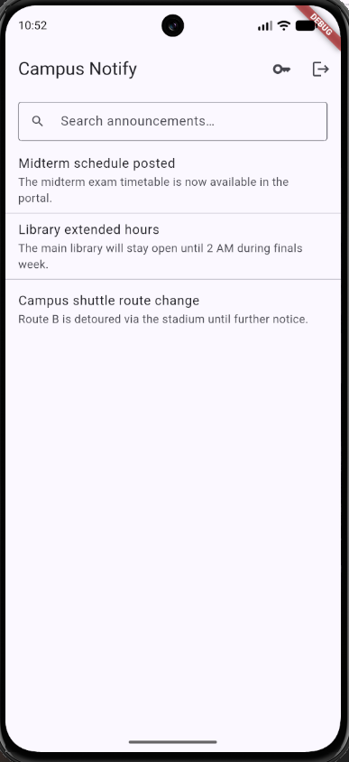
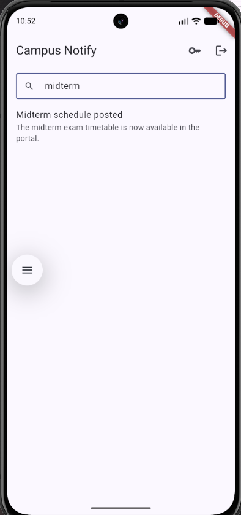
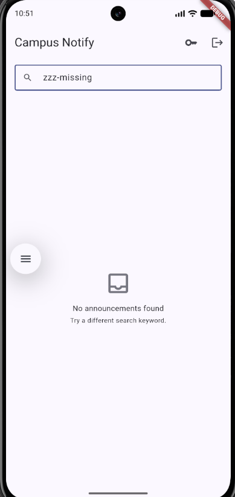

# Flutter Week 9 — AI-Assisted Development (Vibe Coding)

Feature added: **announcement search + explicit empty state** on top of the
Week 7 app **`campus_notify`** ([`07-week-7-clean-architecture`](../07-week-7-clean-architecture)).
The base is the same feature-first Clean Architecture project from Week 7
(auth + secure token storage + FCM + announcement list), continued — not a
new project.

The point of this week is not "the AI wrote code". It is:
**prompt well → verify every line → prove one hallucination with a red test
→ fix small → keep only the parts of the AI output that survive review.**

- 📄 Prompt, context, raw AI output, accept/reject table:
  [`docs/ai-log.md`](docs/ai-log.md)
- 🖼️ Screenshot evidence: [`screenshots/`](screenshots) — embedded below.
- ✅ Green-machine evidence: [`flutter analyze`](#green-machine-evidence) +
  [`flutter test`](#green-machine-evidence) at the bottom.

## Table of Contents

1. [Feature, Stack, and How to Run](#feature-stack-and-how-to-run)
2. [Output Structure](#output-structure)
3. [Lab 1: Prompt and Context Engineering](#lab-1-prompt-and-context-engineering)
4. [Lab 2: Generate and Verify Search](#lab-2-generate-and-verify-search)
5. [Lab 3: Debug and Refactor](#lab-3-debug-and-refactor)
6. [AI Challenge](#ai-challenge)
7. [Refactoring, Testing, and Common Errors](#refactoring-testing-and-common-errors)
8. [Assignment, Reflection, and References](#assignment-reflection-and-references)
9. [Green-Machine Evidence](#green-machine-evidence)

---

## Feature, Stack, and How to Run

### The feature

A search field on the announcement list that:

- filters by **title OR preview**,
- is **case-insensitive** (`GROCERIES` matches `Groceries Sale`),
- returns **all** rows for an empty/blank query,
- shows an explicit **empty state** (`No announcements found`) when nothing matches.

The rule lives in one pure domain use case, so the widget never filters:

```text
HomePage (widget, UI only)
  -> filteredAnnouncementsProvider (derived state)
  -> filterAnnouncements (pure domain use case)
  -> AnnouncementRepository (data: Dio / SQLite)
```

### Stack

| Layer | Choice |
|-------|--------|
| UI | Flutter 3.47.2 / Dart 3.13.2, Material 3 |
| State / DI | `flutter_riverpod ^3.4.3` (no extra DI package) |
| Routing | `go_router ^18.0.2` |
| Remote | `dio` with a 401 auto-refresh interceptor (unchanged from Week 6/7) |
| Local | `sqflite` (repository implementation detail) |
| Lints | `flutter_lints ^6.0.0` |
| AI | AI coding assistant used as generator + first reviewer |

### How to run

```bash
cd 09-week-9-ai-assisted-development
flutter pub get
flutter analyze
dart format --set-exit-if-changed .
flutter test

# Optional: run the app (Firebase config must exist as in Week 7)
flutter run
```

Manual check (3 queries):

1. Open the announcement list → all rows visible.
2. Type `midterm` → only "Midterm Schedule".
3. Type `zzz-missing` → the empty state "No announcements found".

### Screenshots

`screenshots/` contains **only** the three Week 9 captures — the Week 7
login/announcement screenshots were removed because they do not belong to
this assignment.

| Initial list | Filtered (`midterm`) | Empty state (`zzz-missing`) |
|---|---|---|
|  |  |  |

---

## Output Structure

```text
09-week-9-ai-assisted-development/
├── README.md
├── lib/
│   └── features/announcement/
│       ├── domain/
│       │   ├── entities/announcement.dart
│       │   └── usecases/filter_announcements.dart      # Lab 2/3 pure use case
│       ├── data/ (models, datasources, repository impl)
│       └── presentation/
│           ├── providers/announcement_providers.dart   # query + derived state
│           └── pages/home_page.dart                    # UI only
├── docs/
│   └── ai-log.md                                       # prompt + raw output + decisions
├── screenshots/
│   ├── home-initial.png
│   ├── home-filtered.png
│   └── home-empty.png
└── test/
    ├── search_filter_test.dart        # red → green evidence (unchanged)
    ├── home_page_search_test.dart     # widget test for the empty state
    ├── screenshots_test.dart          # golden screenshot generator
    └── ...
```

> The Week 7 documentation files (`docs/ai-prompt.md`, `docs/ai-initial-output.md`,
> `docs/manual-fixes.md`, `docs/review-checklist.md`) are kept because they
> describe the architecture this week builds on. Week 9 evidence is in
> `docs/ai-log.md`.

---

## Lab 1: Prompt and Context Engineering

### 1. Five-slot formula

```text
Role: senior Flutter developer.

Context: existing feature-first project (presentation -> domain <- data),
Riverpod 3, Dio for remote, SQLite for local cache. Feature lives in
lib/features/announcement/. No new package may be added.

Task: add announcement title/preview search + an explicit empty state.
The search rule must be a pure domain use case; the widget must only
render state and forward the raw query.

Limits: keep the existing architecture; do not touch auth, routing, FCM,
the Dio interceptor, or the repository contract. Maximum 80 lines of
new production code.

Output: (1) the use case, (2) the provider wiring, (3) the widget delta,
(4) 3 test cases (case-insensitive match, no-match empty, blank query),
(5) how to run the tests.
```

### 2. Bad versus good

| Bad prompt | Good prompt |
|---|---|
| "make a cool announcement search" | "Add announcement title search. Architecture: presentation -> domain <- data. No SQLite/Dio calls from widgets. Empty state + 1 widget test. Keep the repository contract and the router." |

The good prompt fixes the layer boundary and the deliverable, so the AI
cannot silently put `.where()` inside `build()`.

### 3. Give context, not secrets

Included in the prompt context (pasted as text):

- Folder structure of the `announcement` feature.
- One repository contract (`AnnouncementRepository`) and one use-case contract.
- Package versions from `pubspec.yaml` (`flutter_riverpod ^3.4.3`,
  `go_router ^18.0.2`, `flutter_lints ^6.0.0`, Dart `^3.13.2`).
- What must **NOT** change: auth, secure token storage, router redirect,
  FCM background handler, Dio 401 interceptor, detail page.

Excluded:

- FCM tokens, JWTs, refresh tokens, API keys, passwords, `.env` files.
- The whole 500-file repo; only the relevant snippets.

**Privacy:** no real token appears in this repository. Where a token is
referenced it is written as `TOKEN_PLACEHOLDER` / `JWT_PLACEHOLDER`.

Full prompt and context: [`docs/ai-log.md`](docs/ai-log.md).

---

## Lab 2: Generate and Verify Search

### 1. One small feature

The AI was asked for **one** feature (search + empty state), not a bundle.
The raw prompt and the raw output are archived in
[`docs/ai-log.md`](docs/ai-log.md).

### 2. Six-step verification

| # | Step | Result |
|---|------|--------|
| 1 | Read every line; mark what is not understood | The `caseSensitive:` argument was flagged |
| 2 | Check imports: `domain/` must stay free of Flutter/Dio/SQLite | Pass — only the entity is imported |
| 3 | Check APIs: every method must exist (autocomplete + pub.dev/SDK) | **Fail** — `String.contains` has no `caseSensitive` |
| 4 | Run `flutter analyze` until zero warnings | Red first (2 errors), then green |
| 5 | At least 1 passing and 1 failing search test | `test/search_filter_test.dart` |
| 6 | Manual test: empty query, match, no-match empty state | Done + screenshots |

### 3. Evidence tests

`test/search_filter_test.dart` (the same file in the red and green runs):

```dart
test('filter ignores case', () {
  expect(filterAnnouncements(list, 'groceries'), hasLength(2));
});
test('no-match query returns empty', () {
  expect(filterAnnouncements(list, 'zzz-missing'), isEmpty);
});
```

Plus `empty or blank query returns all items` and `matches on title OR preview`.

### 4. Required evidence: the hallucination

The AI wrote:

```dart
item.title.contains(q, caseSensitive: false)
```

Dart's signature is `bool contains(Pattern other, [int startIndex = 0])` —
there is **no** `caseSensitive` named parameter. `flutter analyze` proved it:

```text
error - The named parameter 'caseSensitive' isn't defined. ...
  filter_announcements.dart:22:33 - undefined_named_parameter
error - The named parameter 'caseSensitive' isn't defined. ...
  filter_announcements.dart:23:35 - undefined_named_parameter

2 issues found. (ran in 50.5s)
```

Fix (v2): normalize both sides with `trim().toLowerCase()` and call the plain
`contains`. Grep now finds the bad parameter only inside the explanatory
comment, never in executable code. Full trace:
[`docs/ai-log.md`](docs/ai-log.md).

---

## Lab 3: Debug and Refactor

### 1. Debug with a red test

1. **Reproduce** — type `midterm`, then `zzz-missing`; v1 did not compile at all.
2. **Isolate** — move the filter into a pure use case
   (`domain/usecases/filter_announcements.dart`).
3. **Red test** — `test/search_filter_test.dart` is written before the fix;
   against v1 it fails to compile.
4. **Fix small** — only the two `contains` calls changed; then
   `flutter test` + `flutter analyze`.
5. **Record root cause** — in [`docs/ai-log.md`](docs/ai-log.md) §2.4.

### 2. Refactor to the correct layers

```text
widget (UI only)        HomePage: TextField + list/empty state
   -> notifier          SearchQueryNotifier: raw query string (state only)
   -> use case           filterAnnouncements: the search rule
   -> repository         AnnouncementRepository: Dio/SQLite behind an interface
```

Concretely:

- `home_page.dart` reads `filteredAnnouncementsProvider`, forwards input to
  `searchQueryProvider.notifier.update`, and renders `_EmptyState` when the
  filtered list is empty. It contains **0** `.where(` calls and **0**
  `domain/usecases` imports.
- `announcement_providers.dart` derives the filtered list with
  `whenData`, so loading/error states survive.
- `filter_announcements.dart` is pure Dart: no Flutter, no Riverpod, no Dio.

### 3. Final verification

```text
flutter analyze
dart format --set-exit-if-changed .
flutter test
```

All three are clean — see [Green-Machine Evidence](#green-machine-evidence).

---

## AI Challenge

### AI role in this codelab

The AI acted as a **fast generator and first reviewer**. Every line was
either accepted, accepted + refactored, or rejected with a written reason.
The AI never owned the merge decision.

### AI Prompt Challenge

```text
Review this Flutter search code as a senior dev.
Context: feature-first (presentation -> domain <- data),
Riverpod, SQLite + Dio.
Focus: correctness, architecture, tests. Ignore style.
Give 3 findings + blocker/suggestion level + reasons.
```

Findings and decisions (details in [`docs/ai-log.md`](docs/ai-log.md) §4):

| # | Finding | Level | Decision | Reason |
|---|---------|-------|----------|--------|
| 1 | Widget still filters inline | blocker | **Accept + fixed** | `grep '.where(' home_page.dart` → 0 after moving the rule to the use case |
| 2 | Add a 300 ms debounce `Timer` | suggestion | **Reject** | 4-item in-memory list; a timer adds leak/flaky-test risk with no measurable gain |
| 3 | Move `searchQueryProvider` into `domain/` | suggestion | **Reject** | The query is UI state; `domain/` must stay framework-free |
| 4 | Return a plain list instead of `AsyncValue` | suggestion | **Accept + refactor** | Keeping `AsyncValue` preserves loading/error from the repository |

A second real finding was caught by `flutter analyze`: Riverpod 3 no longer
exports `Override`, so the first widget-test helper (`List<Override>`) failed
with `non_type_as_type_argument`; the override list is now built inline.

### AI Verification Checklist

- [x] At least 1 AI finding proven true with grep/test evidence, then fixed.
- [x] At least 1 AI finding rejected with written technical reasons.
- [x] Per-file decision: accept, accept + refactor, or reject + write manually.
- [x] Every decision explainable without opening the AI.

### Technical ownership

Kept in [`docs/ai-log.md`](docs/ai-log.md): the five-slot prompt, pasted
context, raw v1 output, proposal-vs-decision table, analyze + test evidence.

---

## Refactoring, Testing, and Common Errors

### Refactoring Challenge

- AI output reduced to small testable units: the filter is a 12-line pure
  function, `HomePage.build` delegates the empty state to `_EmptyState`, and
  no function exceeds 40 lines.
- Filter/search logic moved **out** of the widget into a pure domain use case.
- No cross-layer imports: `domain/` has no Flutter/Dio/Riverpod import;
  `presentation/` does not import `data/` directly.
- `flutter analyze` stays clean.

### Testing

```bash
flutter test test/search_filter_test.dart
flutter test test/home_page_search_test.dart
flutter test test/screenshots_test.dart
flutter test            # everything
```

- `search_filter_test.dart` — 4 domain-rule tests (case, no-match, blank,
  title-or-preview).
- `home_page_search_test.dart` — 2 widget tests: the empty state appears for
  an unmatched query, and clearing the query restores the list.
- Manual test — 3 queries + 3 screenshots.

### Common errors and fixes

| Symptom | Common cause | Fix |
|---------|--------------|-----|
| Missing method / named parameter | API hallucination (`contains(caseSensitive:)`) | Check pub.dev + autocomplete; `flutter analyze`; normalize with `toLowerCase()` |
| Cross-layer import | Weak context | State the layer boundary in the prompt; refactor the filter into `domain/` |
| All tests red | Oversized prompt | Ask for 1 small feature + 1 test; split the task |
| Repeated prompts | No reproduction | Write reproduction steps + a red test first |
| Cannot explain the code | Blind acceptance | Reread it, simplify it, or reject it and write it manually |
| `'Override' isn't a type` | Riverpod 3 stopped exporting the helper type | Build the override list inline in the widget test |

### Self-verification checklist

- [x] Five-slot prompt + context in `docs/ai-log.md`.
- [x] `flutter analyze` clean, `flutter test` green.
- [x] 1 AI finding proven true + 1 rejected with reasons.
- [x] Able to explain every decision without opening the AI.

---

## Assignment, Reflection, and References

### Mini project / Industry challenge

| Requirement | Where |
|---|---|
| One small AI-built feature (search/filter) + empty state | `lib/features/announcement/**`, screenshots below |
| Core prompt + pasted context + initial AI output | [`docs/ai-log.md`](docs/ai-log.md) §1–2 |
| Green-machine evidence (`flutter analyze` + `flutter test`) | [below](#green-machine-evidence) |
| Accept/reject table with technical reasons + grep/test evidence | [`docs/ai-log.md`](docs/ai-log.md) §4 |
| `docs/`, `README.md`, `screenshots/` | this repo |
| README explains feature, prompt, stack, how to run, result | this file |

**Result:** search works for title and preview, is case-insensitive, handles
an empty query, and shows an explicit empty state. Analyze and all tests are
green.

### Reflection

**Which AI hallucination did I find and how did I prove it?**
`String.contains(q, caseSensitive: false)`. It was proven by `flutter analyze`
(`undefined_named_parameter` at `22:33` and `23:35`) and by the Dart SDK
signature `contains(Pattern other, [int startIndex = 0])`. The same test file
that was red became green after the `toLowerCase()` fix.

**Which prompt helped most and what did I change?**
The five-slot prompt with an explicit "no filtering in widgets" constraint and
"max 80 lines". Without the layer constraint the AI put `.where()` in the
widget; adding that one sentence removed an entire refactor round.

**Which refactor did I make to AI code?**
Moved filtering from `home_page.dart` into
`domain/usecases/filter_announcements.dart`; replaced the provider's raw list
with `AsyncValue` + `whenData`; extracted `_EmptyState`; removed the unused
`Override` type from the widget test helper.

**Which accept/reject decision was hardest?**
Rejecting the debounce suggestion. It sounds like a best practice, but with a
4-item in-memory list a `Timer` only adds lifecycle handling and flaky tests.
The decision is recorded with a concrete revisit threshold (pagination or a
large list), so it is a deliberate trade-off, not laziness.

### Supporting references

- Week 9 Slides: AI-Assisted Development / Vibe Coding
- Flutter: [Using IDEs and static analysis](https://docs.flutter.dev/tools/analysis)
- Dart: [Linter rules](https://dart.dev/tools/linter-rules)
- Riverpod: [Getting started](https://riverpod.dev/docs/getting_started)
- GitHub Copilot: [Best practices](https://docs.github.com/en/copilot)
- [Learn Dart in Y Minutes](https://learnxinyminutes.com/docs/dart/)
- [Dart Language Tour](https://dart.dev/language)

---

## Green-Machine Evidence

All commands below were run in `09-week-9-ai-assisted-development/` on the
final tree.

### `flutter analyze`

```text
Analyzing 09-week-9-ai-assisted-development...
No issues found! (ran in 6.9s)
```

### `dart format --set-exit-if-changed .`

```text
Formatted 26 files (0 changed) in 0.22 seconds
```

### `flutter test`

```text
00:00 +0: loading test/home_page_search_test.dart
00:00 +1: test/login_usecase_test.dart: Login returns a valid session on valid credentials
00:00 +2: test/login_usecase_test.dart: Login returns AuthFailure instead of throwing on invalid email
00:00 +3: test/login_usecase_test.dart: Login converts repository exceptions into AuthFailure
00:01 +4: test/home_page_search_test.dart: shows the empty state when the query matches nothing
00:02 +8: test/screenshots_test.dart: home initial list
00:04 +10: test/widget_test.dart: unauthenticated user lands on login page
00:04 +11: test/screenshots_test.dart: home filtered by midterm
00:04 +12: test/screenshots_test.dart: home empty state for unmatched query
00:05 +13: All tests passed!
```