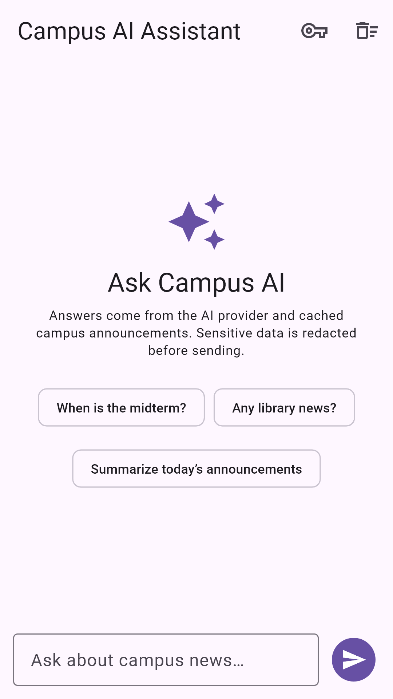
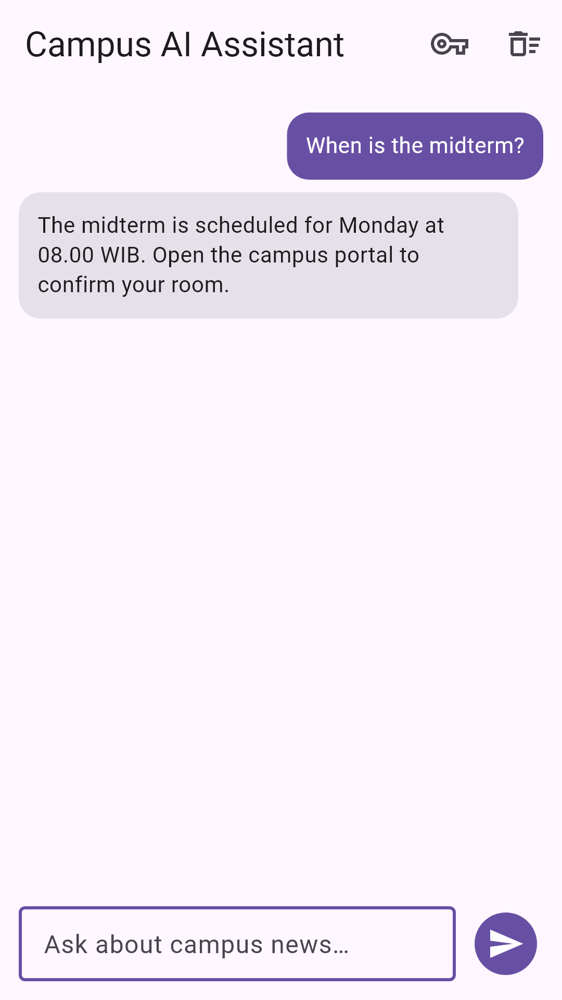
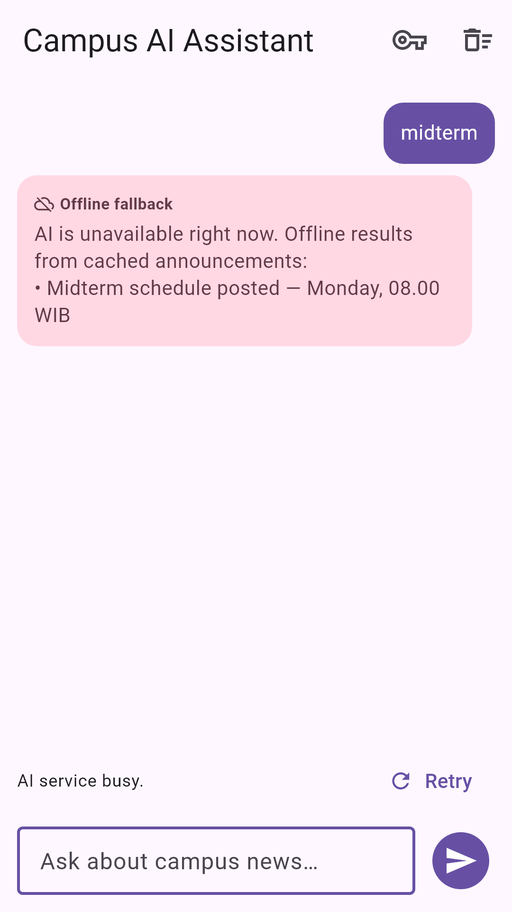
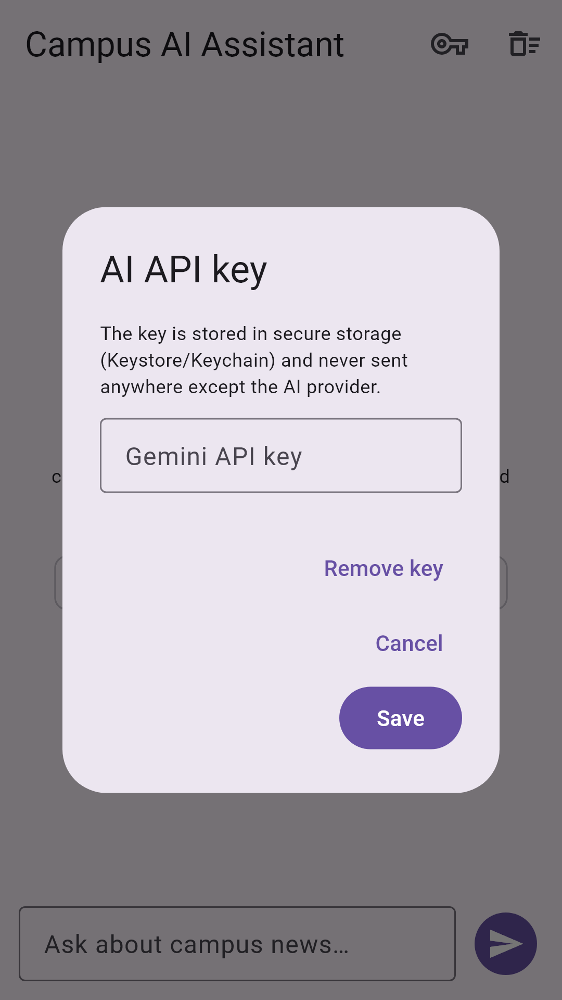

# Flutter Week 10 — AI Feature Integration

Feature added: **Campus AI Assistant**, a streaming chat feature on top of the
Week 9 project [`09-week-9-ai-assisted-development`](../09-week-9-ai-assisted-development)
(the same `campus_notify` app from Week 7). This is a continuation of the
existing feature-first Clean Architecture project, not a new app.

The assistant answers questions about campus announcements, streams the answer
into the chat, stores the provider key in secure storage, redacts sensitive
data before sending, and falls back to cached announcements when the AI API is
unavailable.

## Table of Contents

1. [Feature, Stack, and How to Run](#feature-stack-and-how-to-run)
2. [Screenshots](#screenshots)
3. [Output Structure](#output-structure)
4. [Lab 1: AI Feature Integration Concepts](#lab-1-ai-feature-integration-concepts)
5. [Lab 2: Chat Interface with AI](#lab-2-chat-interface-with-ai)
6. [Lab 3: Privacy, Cost, Error Handling, and Fallback](#lab-3-privacy-cost-error-handling-and-fallback)
7. [Lab 4: OCR, Speech-to-Text, and Image Understanding](#lab-4-ocr-speech-to-text-and-image-understanding)
8. [Assignment and Reflection](#assignment-and-reflection)
9. [Green-Machine Evidence](#green-machine-evidence)
10. [References](#references)

---

## Feature, Stack, and How to Run

### The feature

| Capability | Implementation |
|---|---|
| Chat with streaming answer | `AiApiClient.stream()` reads Gemini SSE and the notifier updates the assistant bubble chunk by chunk |
| Thinking/loading state | Empty assistant bubble shows a spinner + "Thinking…" until the first chunk |
| Key management | Key dialog → `flutter_secure_storage`; never in source or query string |
| Privacy | `redactSensitiveData()` removes NIK, phone, e-mail, passwords, tokens and pasted `AIza…` keys before the request |
| Error handling | 400/401/403/404/429, 5xx, timeout and empty answers map to short friendly messages |
| Model fallback | 404/503 on `gemini-3.8-flash` retries `gemini-3.6-flash`, then `gemini-3.1-flash-lite`, before any text is shown |
| Offline fallback | `offlineFallbackReply()` searches cached announcements and shows a labelled fallback bubble |
| Retry | One-tap retry of the last question, disabled while a request is running |
| Context | Up to 6 cached announcement lines are sent with the question |
| Cost control | `maxOutputTokens: 1024`, `thinkingLevel: low`, truncated context, no history resent, no request loops |

The chat is reachable from the announcement list with the **Ask AI** floating
button (`/ai`).

### Stack

| Layer | Choice |
|---|---|
| UI | Flutter 3.47.2 / Dart 3.13.2, Material 3 |
| State / DI | `flutter_riverpod ^3.4.3` |
| Routing | `go_router ^18.0.2` |
| HTTP | `dio ^5.11.1` (`ResponseType.stream` for SSE) |
| Secure storage | `flutter_secure_storage ^11.2.0` |
| AI provider | Google Gemini API, primary model `gemini-3.8-flash` with automatic fallback to `gemini-3.6-flash` and `gemini-3.1-flash-lite` on 404/503 |
| Lints | `flutter_lints ^6.0.0` |

> **Note on the lab dependency list:** the codelab uses `package:http`. This
> project already ships Dio with a 401 refresh interceptor, and Dio supports
> streaming responses, so adding a second HTTP stack would duplicate timeout,
> logging and interceptor policies. The transport choice is isolated in
> `AiApiClient`; swapping to `http` later is a data-layer-only change.

### How to run

```bash
cd 10-week-10-ai-feature-integration
flutter pub get
flutter analyze
dart format --set-exit-if-changed lib test
flutter test

# Optional: run on a device/emulator (Firebase config is optional, as in Week 9)
flutter run
```

---

## Screenshots

| Initial screen | Streaming conversation |
|---|---|
|  |  |

| Offline fallback + retry | Secure key dialog |
|---|---|
|  |  |


---

## Output Structure

```text
10-week-10-ai-feature-integration/
├── README.md
├── lib/
│   ├── main.dart                              # /ai route added
│   ├── routes.dart                            # Routes.aiChat
│   └── features/ai/
│       ├── domain/
│       │   ├── entities/chat_message.dart
│       │   ├── repositories/ai_repository.dart
│       │   └── usecases/
│       │       ├── build_campus_prompt.dart   # system prompt + redaction + validation
│       │       └── offline_fallback.dart      # cached-announcement fallback
│       ├── data/
│       │   ├── ai_api_client.dart             # Gemini SSE + non-streaming ask
│       │   ├── ai_key_store.dart              # secure storage gateway
│       │   └── repositories/ai_repository_impl.dart
│       └── presentation/
│           ├── providers/ai_providers.dart    # DI, context, chat notifier
│           └── pages/ai_chat_page.dart        # UI only
├── docs/
│   ├── ai-log.md
│   ├── prompt-design.md
│   └── risk-and-privacy.md
├── screenshots/
│   ├── ai-chat-initial.png
│   ├── ai-chat-conversation.png
│   ├── ai-chat-fallback.png
│   └── ai-chat-key-dialog.png
└── test/
    ├── ai_prompt_test.dart        # privacy, prompt, fallback (8 tests)
    ├── ai_chat_test.dart          # streaming, fallback+retry, missing key, SSE retry (4 tests)
    ├── ai_repository_test.dart    # 401/404/429/timeout mapping, retry + model fallback (6 tests)
    ├── screenshots_test.dart      # deterministic PNG evidence
    └── ...                        # Week 9 search/auth tests kept green
```

Dependency direction:

```text
AiChatPage (presentation, UI only)
  -> aiChatProvider (state)
     -> buildCampusPrompt / validateAiReply / offlineFallbackReply (domain, pure)
     -> AiRepository (domain contract)
        -> AiRepositoryImpl (data: Dio + secure storage)
```

`domain/` imports no Flutter, Dio, Riverpod or secure-storage package; the
widget never calls the API.

---

## Lab 1: AI Feature Integration Concepts

### 1. What is AI feature integration?

The app talks to a cloud model over HTTPS and turns the result into a normal
mobile interaction:

- **Chat assistant** — real-time Q&A with an LLM API (**implemented here**);
- **OCR** — text extraction from an image/document;
- **Speech-to-Text** — voice input converted to text;
- **Image understanding** — captioning/analysis;
- **Recommendation** — personalised suggestions from user data.

### 2. Integration architecture

```text
+----------------+      HTTPS/SSE      +----------------+
|   Flutter UI   | <-----------------> |   AI API       |
|  Chat / OCR /  |      (Dio)          |  (Gemini LLM)  |
|  STT / Image   |                     |                |
+----------------+                     +----------------+
        |                                      |
        | API key: secure storage              | short answer
        v                                      v
+----------------+      optional       +----------------+
|  Local cache   | <-----------------> |   Backend      |
|  (announcement |     (batching)      | (auth, quota,  |
|   repository)  |                     |  logging)      |
+----------------+                     +----------------+
```

Applied rules:

- the API key is never hard-coded; it is read from secure storage;
- requests are bounded (`maxOutputTokens`, truncated context);
- the local announcement repository is the fallback source;
- in production the key should move to a backend proxy so it never ships to a
  device (documented as future work).

### 3. Prompt design for mobile

| Component | Example | Purpose |
|---|---|---|
| System prompt | "You are the Campus Notify assistant… max 2 sentences… never ask for NIK, phone, e-mail…" | Persona and boundaries |
| User prompt | "When is the midterm?" | The student's input |
| Context | Up to 6 cached announcement lines | Grounding and relevance |
| Limits | `maxOutputTokens: 1024`, `thinkingLevel: low`, no history, 600-char validation | Privacy, cost, readability |

The full prompt rationale is in [`docs/prompt-design.md`](docs/prompt-design.md).
Tips applied: keep prompts short, mirror the language of the question, ask the
model to admit "I don't know", and validate the output before rendering.

---

## Lab 2: Chat Interface with AI

### 1. Dependencies

The feature uses packages already present in Week 9 (`dio`,
`flutter_secure_storage`, `flutter_riverpod`); no new package is added. If you
build the lab version with `http`, the dependency block is:

```yaml
dependencies:
  flutter:
    sdk: flutter
  http: ^1.2.0
  flutter_secure_storage: ^9.0.0
  riverpod: ^2.5.0
```

This project uses `flutter_riverpod` (not plain `riverpod`) because the UI
already uses `ConsumerWidget`.

### 2. AI service

The data layer owns HTTP and key lookup:

```dart
// lib/features/ai/data/ai_api_client.dart (abridged)
Stream<String> stream({required String systemPrompt, required String userPrompt}) async* {
  final key = await _requireKey();
  final response = await _dio.post<ResponseBody>(
    '/models/$model:streamGenerateContent',
    queryParameters: const {'alt': 'sse'},
    data: _payload(systemPrompt: systemPrompt, userPrompt: userPrompt),
    options: Options(
      responseType: ResponseType.stream,
      headers: {'x-goog-api-key': key}, // never ?key=...
    ),
  );

  await for (final line in response.data!.stream
      .cast<List<int>>()
      .transform(utf8.decoder)
      .transform(const LineSplitter())) {
    if (!line.startsWith('data:')) continue;
    final text = _extractText(line.substring(5).trim());
    if (text.isNotEmpty) yield text;
  }
}
```

The non-streaming `generateContent` endpoint is available as a fallback path;
the repository maps both transports into the same domain contract.

### 3. Chat screen

`lib/features/ai/presentation/pages/ai_chat_page.dart` contains only UI:

- welcome screen with suggested questions;
- user/assistant bubbles (assistant bubble shows a spinner while empty);
- fallback bubble with an `Offline fallback` label and a **Retry** action;
- key dialog (save/remove) and a banner when no key is configured;
- input row with a send button disabled while streaming.

State and network logic live in `AiChatNotifier`; the prompt and redaction live
in the domain layer. Security note applied: NIK, phone numbers, addresses,
e-mails, passwords and provider keys are never sent to the AI API.

### 4. Verification of the integration

| Check | Evidence |
|---|---|
| Streaming works | `ai_chat_test.dart` asserts the two streamed chunks form one answer |
| Retry works | The fallback test flips the fake from failing to healthy and taps Retry |
| Missing key | Widget test asserts the banner; no request is attempted |
| Key not in source | `grep "AIza" lib test` finds only the redaction regex, an input hint and an unmistakably fake test fixture |
| No raw error | Provider errors are mapped through `mapAiError()` before the UI |

The AI-generated `(?i)` regex was rejected by `flutter analyze` (`valid_regexps`)
and replaced with `RegExp(..., caseSensitive: false)`. The retry state bug was
caught by a red widget test. Details: [`docs/ai-log.md`](docs/ai-log.md).

---

## Lab 3: Privacy, Cost, Error Handling, and Fallback

| Risk | Mitigation in this project |
|---|---|
| User data leakage | Redaction before sending; no sensitive fields in the UI; no prompt logging |
| Credential leakage | Secure storage + `x-goog-api-key` header; key dialog has a remove action |
| Cost spike | `maxOutputTokens: 1024`, `thinkingLevel: low`, context capped at 6 lines, no history resent, no auto-retry loop; model fallback is capped at 3 models and only on 404/503 |
| API error/down | Mapped friendly message, offline fallback from cached announcements, Retry button |
| Rate limit | 429 message asks the user to wait; production quota belongs on the server |
| Irrelevant response | "Use only the context / say you don't know" system prompt + reply validation |
| Double send | `isStreaming` guard and disabled send/retry buttons |

Fallback example (the pattern implemented in `AiChatNotifier`):

```dart
try {
  await for (final chunk in aiRepository.streamAnswer(...)) {
    // append chunk to the assistant bubble
  }
} catch (e) {
  final message = e is AiRequestException
      ? e.message
      : 'The AI request failed. Using local data.';
  final fallback = offlineFallbackReply(question, cachedAnnouncements);
  // show the fallback bubble + the message + a Retry button
}
```

The complete risk register is in
[`docs/risk-and-privacy.md`](docs/risk-and-privacy.md).

---

## Lab 4: OCR, Speech-to-Text, and Image Understanding

The assignment requires **one** AI feature; this project integrates the chat
assistant. The same layering is ready for the other modalities:

| Feature | Plugin | Domain method (extension point) | Where it would connect |
|---|---|---|---|
| OCR | `image_picker` + camera/gallery | `recognizeText(File image)` | Same `AiRepository`, new page under `features/ai/` |
| Speech-to-Text | `record` / `just_audio` | `speechToText(File audio)` | Same repository, input microphone button on the chat page |
| Image understanding | `image_picker` | `describeImage(File image)` | New screen; prompt asks for a caption/description |

The lab snippet maps to:

```dart
final result = await aiRepository.recognizeText(imageFile);
final text = await aiRepository.speechToText(audioFile);
```

Implementation notes if these are added:

- images/audio go through the **data layer** only; the domain receives text;
- resize images and cap audio length to control cost;
- never upload IDs or documents containing NIK/addresses without explicit
  consent and a retention policy;
- keep the same error mapping and fallback pattern;
- add `image_picker`/`record` permissions to the Android/iOS manifests.

---

## Assignment and Reflection

### Mini project / industry challenge

| Requirement | Where |
|---|---|
| One AI feature integrated into an existing project | Streaming chat in `lib/features/ai/**`; entry point on the announcement list |
| System prompt, user prompt, initial AI output | [`docs/ai-log.md`](docs/ai-log.md) §1.4 and §2.5 |
| Green-machine evidence (`flutter analyze` + `flutter test`) | [below](#green-machine-evidence) |
| Risk table + privacy and cost mitigation | [`docs/risk-and-privacy.md`](docs/risk-and-privacy.md) and [Lab 3](#lab-3-privacy-cost-error-handling-and-fallback) |
| `lib/`, `docs/`, `README.md`, `screenshots/` | this folder |
| README explains feature, prompt, stack, how to run, result | this file |

**Result:** the assistant streams an answer, keeps the key in secure storage,
redacts sensitive values before the request, shows a thinking state, and falls
back to cached announcements with a retry when the provider is unavailable.
`flutter analyze` is clean and all 32 tests pass.

### Reflection

**Which AI feature did I integrate and why?**
The chat assistant, because it is the highest-value feature for a campus
announcement app: students can ask a natural question instead of scanning the
list. It also exercises the full stack — streaming, secure storage, prompt
design, privacy redaction and fallback — so it demonstrates the integration
concepts better than a one-shot OCR call.

**How do I protect user privacy when using the AI API?**
Sensitive values are redacted in the domain layer before the request; the API
key is stored in Keystore/Keychain and sent in a header, not a URL; no prompt or
response is logged; the context is limited to announcement titles/previews; and
the docs describe moving the key to a backend proxy for production. Each rule
has a unit test or a documented review decision.

**What fallback do I provide if the AI service errors?**
The failed assistant bubble is replaced by a labelled "Offline fallback" bubble
that searches the cached announcements. If nothing matches, it points the
student to the campus portal. The mapped error and a **Retry** button are shown,
and retry is guarded against double taps.

**One thing I learned about AI feature UX on mobile.**
Latency is part of the UX: showing a "Thinking…" bubble and streaming the first
chunk changes the perceived wait far more than a spinner on a blank screen. A
second lesson is that the fallback must be designed as a first-class state, not
an afterthought — users still need the announcement data when the AI is down.

---

## Green-Machine Evidence

All commands below were run in `10-week-10-ai-feature-integration/` on the final
tree.

### `flutter analyze`

```text
Analyzing 10-week-10-ai-feature-integration...
No issues found! (ran in 9.2s)
```

### `dart format --set-exit-if-changed lib test`

```text
Formatted 37 files (0 changed) in 0.39 seconds
```

### `flutter test`

```text
00:21 +32: All tests passed!
```

Test groups:

- `ai_prompt_test.dart` — 8 tests: redaction (NIK/phone/e-mail/secret/provider
  key), prompt assembly, context truncation, reply validation, offline fallback.
- `ai_chat_test.dart` — 4 tests: streaming success, fallback + retry, missing
  key banner, and SSE timeout retrying through the non-streaming endpoint.
- `ai_repository_test.dart` — 6 tests: 401, 404, 429, timeout and unknown-error
  mapping plus the retryable flag and the model-fallback decision (guards the
  `yield*` regression).
- `screenshots_test.dart` — 4 golden screenshots.
- Week 9 tests (`search_filter_test.dart`, `home_page_search_test.dart`,
  `login_usecase_test.dart`, `widget_test.dart`) remain green.

Manual evidence: the four screenshots above, generated from the real widgets
with a fake AI repository.

---

## References

- Week 10 Slides: AI Feature Integration
- [Google Gemini API](https://ai.google.dev/gemini-api/docs)
- [Gemini streaming with SSE](https://ai.google.dev/gemini-api/docs/text-generation#streaming)
- [`flutter_secure_storage`](https://pub.dev/packages/flutter_secure_storage)
- [`dio`](https://pub.dev/packages/dio)
- [`http`](https://pub.dev/packages/http)
- [Riverpod: Getting started](https://riverpod.dev/docs/getting_started)
- [Flutter static analysis](https://docs.flutter.dev/tools/analysis)
- [Learn Dart in Y Minutes](https://learnxinyminutes.com/docs/dart/)
- [Dart Language Tour](https://dart.dev/language)
