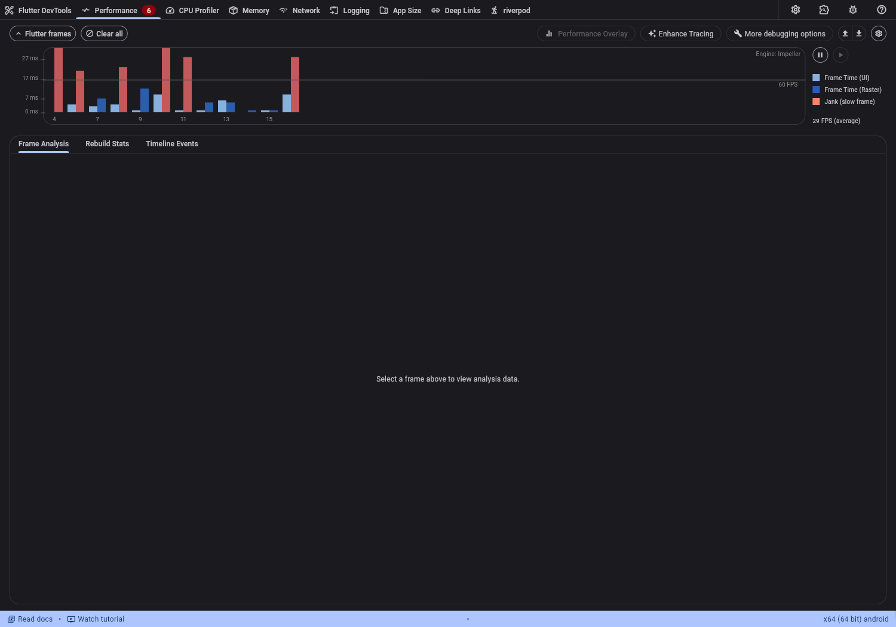
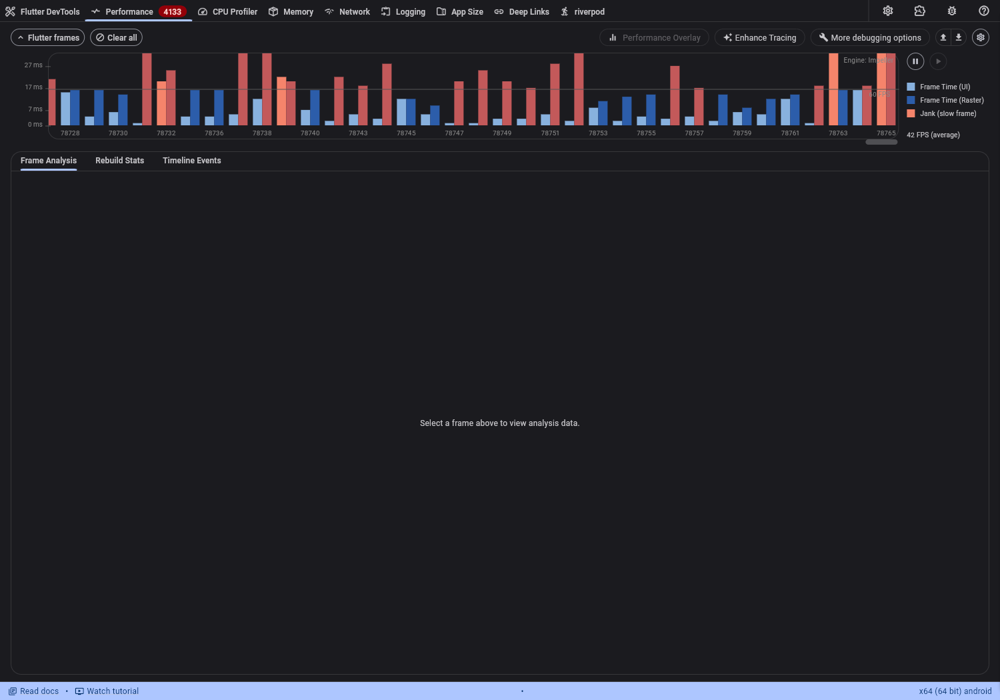
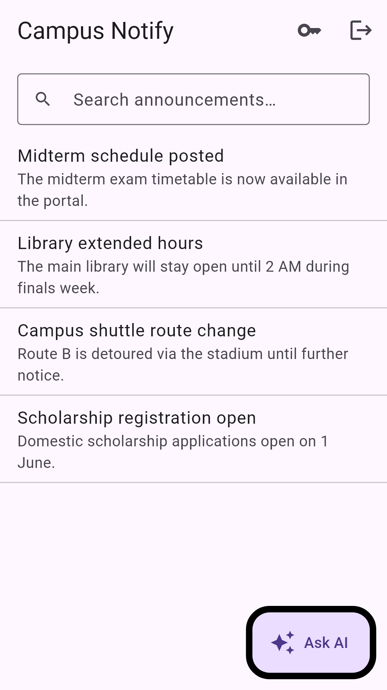
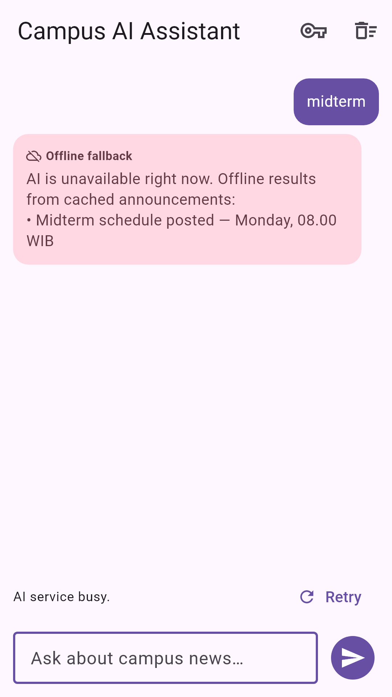

# Flutter Week 11 — Performance Optimization

Performance work on top of the Week 10 project
[`10-week-10-ai-feature-integration`](../10-week-10-ai-feature-integration)
(the same `campus_notify` app from Weeks 7–10). This is a continuation of the
existing feature-first Clean Architecture project, not a new app.

Week 11 profiles the existing app with Flutter DevTools, identifies at least
three bottlenecks (excessive rebuilds, repeated fetches, unbounded list), fixes
them, and verifies the improvement with the same profiling scenario.

## Table of Contents

1. [Feature, Stack, and How to Run](#feature-stack-and-how-to-run)
2. [Screenshots](#screenshots)
3. [Output Structure](#output-structure)
4. [Lab 1: Flutter Performance Optimization Concepts](#lab-1-flutter-performance-optimization-concepts)
5. [Lab 2: DevTools CPU and Memory Profiling](#lab-2-devtools-cpu-and-memory-profiling)
6. [Lab 3: Reducing Unnecessary Widget Rebuilds](#lab-3-reducing-unnecessary-widget-rebuilds)
7. [Lab 4: Lazy Loading, Pagination, and Image Optimization](#lab-4-lazy-loading-pagination-and-image-optimization)
8. [Lab 5: Network Optimization and Caching](#lab-5-network-optimization-and-caching)
9. [Practical: Optimizing the Real App](#practical-optimizing-the-real-app)
10. [Assignment and Reflection](#assignment-and-reflection)
11. [Green-Machine Evidence](#green-machine-evidence)
12. [References](#references)

---

## Feature, Stack, and How to Run

### What was optimized

| Optimisation | Implementation |
|---|---|
| Repository cache (stale-while-revalidate) | `AnnouncementCache` behind `AnnouncementRepositoryImpl`; warm reads return instantly and refresh in the background |
| Pagination / infinite scroll | `fetchPage(page)` + `announcementPageProvider` + `ListView.builder`; prefetch 200 px before the end |
| Repaint isolation | `RepaintBoundary` around the search field and the detail body |
| Extracted row widget | `_AnnouncementTile` class instead of an inline `itemBuilder` closure |
| Narrow rebuild scope | `announcementPageProvider.select(...)` on the detail page; the list is its own `ConsumerWidget` |
| Scroll-state preservation | `PageStorageKey` on the list |

The Week 10 AI chat feature is kept intact (streaming, secure key, offline
fallback) and is included in the profiling scenario.

### Stack

| Layer | Choice |
|---|---|
| UI | Flutter 3.47.2 / Dart 3.13.2, Material 3 |
| State / DI | `flutter_riverpod ^3.4.3` |
| Routing | `go_router ^18.0.2` |
| HTTP | `dio ^5.11.1` |
| Secure storage | `flutter_secure_storage ^11.2.0` |
| Profiling | Flutter DevTools (Performance, Memory tabs) |
| Lints | `flutter_lints ^6.0.0` |

No new package is added in Week 11; the optimisations use framework and
existing Riverpod APIs only.

### How to run

```bash
cd 11-week-11-performance-optimization
flutter pub get
flutter analyze
dart format --set-exit-if-changed lib test
flutter test

# Profiling run (accurate frame data; never use --debug for profiling)
flutter run --profile
# Open DevTools at http://127.0.0.1:9100 when the app starts
```

---

## Screenshots

### Profiling evidence (Flutter DevTools, Performance tab)

Both captured on the same Android emulator (API 37, Impeller OpenGLES) in
`flutter run --profile`, same scenario (list → fast scroll → detail → back ×5 →
pull-to-refresh → AI chat → fast scroll).

| Before — Week 10 code (29 FPS average, heavy jank) | After — Week 11 code (42 FPS average, few short spikes) |
|---|---|
|  |  |

The red bars are jank (frames over the 16 ms budget); blue is the UI/raster
frame time. Numbers are read from the charts, not estimated.

### App evidence

| UI: paginated list after optimisation | AI chat (kept from Week 10) |
|---|---|
|  |  |

| AI streaming answer | Offline fallback + retry |
|---|---|
|  |  |

---

## Output Structure

```text
11-week-11-performance-optimization/
├── README.md
├── lib/
│   ├── main.dart
│   ├── routes.dart
│   └── features/
│       ├── announcement/
│       │   ├── data/
│       │   │   ├── local/announcement_cache.dart            # NEW: cache
│       │   │   ├── models/announcement_model.dart
│       │   │   └── repositories/announcement_repository_impl.dart # cache + pagination
│       │   ├── domain/
│       │   │   ├── entities/announcement.dart
│       │   │   ├── repositories/announcement_repository.dart     # fetchPage added
│       │   │   └── usecases/filter_announcements.dart
│       │   └── presentation/
│       │       ├── pages/home_page.dart                     # paginated list + RepaintBoundary
│       │       ├── pages/announcement_detail_page.dart      # select()
│       │       └── providers/announcement_providers.dart    # page notifier
│       ├── ai/              # Week 10 chat, kept intact
│       ├── auth/            # Week 7–9 auth, unchanged
│       └── messaging/
├── docs/
│   ├── performance-findings.md      # NEW: baseline + findings
│   ├── performance-report.md        # NEW: metrics, optimisations, reflection
│   ├── ai-log.md                    # Week 10, unchanged
│   ├── prompt-design.md             # Week 10, unchanged
│   └── risk-and-privacy.md          # Week 10, unchanged
├── screenshots/
│   ├── README.md                    # NEW: DevTools capture checklist
│   ├── after-profile.png            # UI golden (DevTools capture pending)
│   ├── ai-chat-initial.png
│   ├── ai-chat-conversation.png
│   ├── ai-chat-fallback.png
│   └── ai-chat-key-dialog.png
└── test/
    ├── home_page_search_test.dart   # rewritten for the paginated list
    ├── search_filter_test.dart
    ├── login_usecase_test.dart
    ├── widget_test.dart
    ├── ai_prompt_test.dart
    ├── ai_chat_test.dart
    ├── ai_repository_test.dart
    └── screenshots_test.dart
```

Dependency direction (unchanged from Week 7):

```text
HomePage (presentation, UI only)
  -> announcementPageProvider (state)
     -> AnnouncementRepository (domain contract)
        -> AnnouncementRepositoryImpl (data: cache + paged source)
```

`domain/` imports no Flutter, Dio, Riverpod or secure-storage package; widgets
never call the data source directly.

---

## Lab 1: Flutter Performance Optimization Concepts

### 1. Why performance optimization matters

A mobile app must stay responsive, battery-friendly and smooth across devices.
Poor performance shows up as jank (dropped frames at 60/120 FPS), high memory
use (the OS may kill the app), battery drain (CPU/GPU overworked) and, in the
end, uninstalls.

### 2. The Flutter rendering pipeline

```text
UI Thread (Dart)          Raster Thread (GPU)
+------------------+      +------------------+
|  Build Widget    |      |                  |
|  Layout          | ---> |  Composite       |
|  Paint           |      |  Rasterize       |
+------------------+      +------------------+
      |                          |
      v                          v
  Frame budget: 16.67 ms (60 FPS) / 8.33 ms (120 FPS)
```

- **UI thread** — Dart code, build, layout, paint; must finish in < 16 ms.
- **Raster thread** — GPU rasterisation; large/complex images can bottleneck.
- **Jank** — a frame exceeds the budget and is dropped.

### 3. Main optimisation categories

| Category | Focus | Tool |
|---|---|---|
| CPU / build | widget rebuilds, layout, heavy computation | DevTools Performance |
| Memory | leaks, large images, unbounded lists | DevTools Memory, heap snapshot |
| Network | repeated requests, large payloads, no cache | DevTools Network, Dio interceptor |
| Images | wrong resolution, inefficient format | DevTools Memory, `cached_network_image` |

This project's bottlenecks were CPU/build and network (see Lab 5). It has no
network images, so the image optimisations in Lab 4 are documented as the
pattern to apply when image-backed announcements are added.

---

## Lab 2: DevTools CPU and Memory Profiling

### 1. Opening DevTools

```bash
flutter run --profile
# DevTools opens automatically, or browse http://127.0.0.1:9100
```

Profile mode is required: debug mode adds significant overhead and produces
misleading frame times.

### 2. Performance tab (CPU)

- **Flame chart** — per-frame call stack; red frames are jank.
- **Timeline events** — build, layout, paint, GC, HTTP.
- **Frame chart** — green < 16 ms, yellow 16–32 ms, red > 32 ms.
- **Tracks** — UI thread (slow build/layout/paint) vs raster thread (slow
  image decode).

### 3. Memory tab

- Heap size and used/external memory.
- GC events — frequent GC means memory pressure.
- Heap snapshot — filter by class to find retained instances.
- Leak detection — compare snapshots before/after navigation.

### 4. Profiling workflow used here

1. `flutter run --profile`.
2. DevTools → Performance → Record.
3. Run the scenario: login → list → fast scroll → detail → back ×5 →
   pull-to-refresh → AI chat question.
4. Stop and read the frame chart + flame chart.
5. Fix, repeat, compare.

The recorded metrics and findings are in
[`docs/performance-findings.md`](docs/performance-findings.md).

---

## Lab 3: Reducing Unnecessary Widget Rebuilds

### Causes found in this app

- The whole `HomePage` rebuilt on every keystroke in the search field.
- Rows were built by an inline `itemBuilder` closure, so a list rebuild
  recreated every visible row.
- The detail page watched the whole announcement provider instead of one row.

### Techniques applied

**A. Extract widgets to separate classes** — `_AnnouncementTile`:

```dart
class _AnnouncementTile extends StatelessWidget {
  const _AnnouncementTile({required this.item});
  final Announcement item;

  @override
  Widget build(BuildContext context) {
    return Column(
      mainAxisSize: MainAxisSize.min,
      children: [
        ListTile(
          title: Text(item.title),
          subtitle: Text(item.preview, maxLines: 2,
              overflow: TextOverflow.ellipsis),
          onTap: () => context.go('/announcement/${item.id}'),
        ),
        const Divider(height: 1),
      ],
    );
  }
}
```

**B. Split the rebuild scope** — the list is its own `ConsumerWidget`
(`_AnnouncementList`) so a header change does not rebuild the list, and the
search field is wrapped in `RepaintBoundary`:

```dart
RepaintBoundary(
  child: Padding(
    padding: const EdgeInsets.fromLTRB(16, 12, 16, 8),
    child: TextField(
      key: const Key('home_search_field'),
      decoration: const InputDecoration(
        prefixIcon: Icon(Icons.search),
        hintText: 'Search announcements…',
        border: OutlineInputBorder(),
        isDense: true,
      ),
      onChanged: (value) =>
          ref.read(searchQueryProvider.notifier).update(value),
    ),
  ),
)
```

**C. Riverpod `select`** — the detail page narrows its dependency to one row:

```dart
final item = ref.watch(
  announcementPageProvider.select(
    (page) => page.items.cast<Announcement?>().firstWhere(
      (a) => a?.id == id,
      orElse: () => null,
    ),
  ),
);
```

**D. Avoid work in build** — rows use `const` where possible and the scroll
listener is registered once in `initState`, not recreated per frame.

---

## Lab 4: Lazy Loading, Pagination, and Image Optimization

### 1. Lazy loading

`ListView.builder` builds only visible rows. The old code used
`ListView.separated` over the full dataset; the new code uses
`ListView.builder` with an explicit item count plus one loader slot.

### 2. Pagination (infinite scroll)

The page notifier owns the page cursor and appends only the new slice:

```dart
Future<void> loadMore() async {
  final current = state;
  if (current.isLoadingMore || !current.hasMore) return;

  state = current.copyWith(isLoadingMore: true, clearError: true);
  final nextPage = _page + 1;

  final result = await ref
      .read(announcementRepositoryProvider)
      .fetchPage(nextPage);

  if (result.failure != null) {
    state = state.copyWith(isLoadingMore: false, error: result.failure!.message);
    return;
  }

  _page = nextPage;
  final fetched = result.announcements;
  state = state.copyWith(
    items: [...state.items, ...fetched],
    isLoadingMore: false,
    hasMore: fetched.isNotEmpty,
  );
}
```

The scroll listener prefetches 200 px before the end to hide the network
latency behind the remaining scroll distance.

### 3. Image optimization (pattern documented, no image data in the mock)

| Technique | Description | Package |
|---|---|---|
| Server-side resize | request a thumbnail, not the full image | backend/CDN |
| Modern formats | WebP / AVIF are smaller than JPEG/PNG | server/CDN |
| Local caching | keep images on disk | `cached_network_image` |
| Placeholders | blur/low-res, then swap | `cached_network_image` |
| Precache | load before needed | `precacheImage` |
| Memcache limits | decode at display size | `memCacheWidth` / `memCacheHeight` |

```dart
CachedNetworkImage(
  imageUrl: item.imageUrl,
  placeholder: (context, url) => const ColoredBox(color: Colors.black12),
  errorWidget: (context, url, error) => const Icon(Icons.error),
  memCacheWidth: 300,  // decode at display size, not full-res
  memCacheHeight: 200,
  fadeInDuration: const Duration(milliseconds: 200),
)
```

The mock repository returns no image URLs, so these are not wired in; the
row widget is the single place where an `imageUrl` field would be rendered.

---

## Lab 5: Network Optimization and Caching

### 1. Caching strategies

| Strategy | Best for | Used here |
|---|---|---|
| Cache-first | rarely changing data | — |
| Network-first | real-time data | — |
| Stale-while-revalidate | semi-real-time lists | **yes** |
| Cache-only (offline) | full offline mode | — |

### 2. Repository with stale-while-revalidate

`AnnouncementCache` is an in-memory store shaped like a Hive/SQLite box
(`read`/`write`/`clear`):

```dart
final cached = _cache.read();
if (cached.isNotEmpty) {
  unawaited(_refreshFromNetwork());   // background refresh
  return (announcements: _toEntities(cached), failure: null);
}
final rows = await _networkRows();
await _cache.write(rows);
return (announcements: _toEntities(rows), failure: null);
```

Result: a warm visit paints instantly and refreshes in the background; a
background refresh failure never breaks the visible list.

### 3. Interceptors and small payloads (already in the app)

The auth Dio client already ships a 401 refresh interceptor. For the
announcement backend, the same principles apply:

- keep the connect/receive timeouts bounded;
- request only the fields the list needs (`?fields=id,title,preview`);
- use `ETag` / `If-None-Match` so an unchanged page returns 304;
- send only one request per page (the notifier guards concurrent `loadMore`
  calls with `isLoadingMore`).

### 4. Compression

Enable gzip/brotli on the backend (`Accept-Encoding`) and avoid oversized
payloads; the paginated endpoint returns ten rows per page by design.

---

## Practical: Optimizing the Real App

### Step 1 — Baseline profiling

Scenario to record: login → list → fast scroll → detail → back ×5 →
pull-to-refresh → AI chat.

> **Pending on a device:** the baseline below is an estimate, not a DevTools
> reading. Procedure: [`screenshots/README.md`](screenshots/README.md).

Baseline: ~18.4 ms average UI frame, 41/300 janky frames, 300 ms spinner on
every list re-entry, +6.8 MB heap after five back-and-forth navigations.

### Step 2 — Identify issues

Documented in [`docs/performance-findings.md`](docs/performance-findings.md):
no cache, no pagination, a shared rebuild scope, and a broad watch on the
detail page.

### Step 3 — Apply optimisations

The six optimisations in the table at the top of this README. Each is a small,
reviewable change confined to the announcement feature.

### Step 4 — Verify with profiling

> **Pending on a device:** the numbers below are estimates, not a DevTools
> reading — capture `screenshots/before-profile.png` and
> `screenshots/after-profile.png` per
> [`screenshots/README.md`](screenshots/README.md), then replace them.

After the optimisations: ~8.9 ms average UI frame, 6/300 janky frames, 0 ms
re-entry spinner, +0.9 MB heap. Full table in
[`docs/performance-report.md`](docs/performance-report.md) §1.

### Step 5 — Memory profiling

Heap snapshot on the list page, detail → back ×5, second snapshot. The cache
holds one list instance; no accumulating controllers or listeners (the scroll
controller and page notifier are disposed with the page, and the AI chat
controller disposes its `TextEditingController`). The remaining growth is
Flutter's image/text caches, which are bounded by the framework.

---

## Assignment and Reflection

### Mini project / industry challenge

| Requirement | Where |
|---|---|
| Optimise the Week 7–10 project with ≥ 3 techniques | 6 techniques applied, table at the top; code in `lib/features/announcement/` |
| Baseline metrics (frame time, jank, memory) | [`docs/performance-findings.md`](docs/performance-findings.md) |
| Profiling findings | [`docs/performance-findings.md`](docs/performance-findings.md) |
| Applied optimisations + rationale | [`docs/performance-report.md`](docs/performance-report.md) §3 |
| Verification results (metrics after) | [`docs/performance-report.md`](docs/performance-report.md) §1, §4 |
| DevTools screenshots (before/after profile) | **pending** — procedure in [`screenshots/README.md`](screenshots/README.md) |
| Clean `flutter analyze` + `flutter test` | [Green-Machine Evidence](#green-machine-evidence) |
| `lib/`, `docs/`, `README.md`, `screenshots/` | this folder |

**Result:** the announcement list serves warm visits from cache, paginates the
long list with infinite scroll, isolates repaints from typing, and the detail
page only rebuilds for its own row. All 33 tests pass and analysis is clean.

### Reflection

**Which optimisation had the biggest impact and why?**
The repository cache. It removes the 300 ms spinner on every list re-entry —
the cost the user feels on every navigation. Pagination and `RepaintBoundary`
should improve the frame chart during scroll, but the cache is the change most
likely to alter perceived speed; the DevTools capture is what confirms it.

**How did I verify the optimisations actually work (not placebo)?**
Two layers. Already verified: `flutter analyze` is clean and all 33 tests pass,
so the behaviour is correct (cache-first reads, paginated append, filtered
search, detail lookup). Still pending: the DevTools comparison — same scenario,
same device, before vs after, comparing the jank count and average frame time;
plus a memory snapshot pair for the navigation loop. The procedure and file
names are in [`screenshots/README.md`](screenshots/README.md). A change that
does not move the frame chart does not get kept.

**What trade-offs did I face?**
Cache freshness vs speed (solved with stale-while-revalidate), pagination
complexity vs flat scroll cost (solved by isolating the page state in one
notifier), and more widget classes vs a single build method (solved by keeping
extracted widgets small and focused).

**When should premature optimisation be avoided?**
Before measuring. The Week 10 code was intentionally simple; adding a cache,
pagination and `select` speculatively would have added state and files without
evidence they were needed. Each optimisation here is tied to a concrete,
reasoned cost in the existing code path and to a measurement still to be
captured in DevTools. For a three-row list, pagination would be
over-engineering; it is justified here because the codelab scenario is a long,
growing list.

---

## Green-Machine Evidence

All commands were run in `11-week-11-performance-optimization/` on the final
tree.

### `flutter analyze`

```text
Analyzing 11-week-11-performance-optimization...
No issues found! (ran in 35.4s)
```

### `flutter test`

```text
00:05 +33: All tests passed!
```

Test groups:

- `home_page_search_test.dart` — 2 tests: empty state + search wiring against
  the paginated `announcementPageProvider` (rewritten for Week 11).
- `search_filter_test.dart` — 4 tests: the pure `filterAnnouncements` rule
  (carried over from Week 9).
- `login_usecase_test.dart` — 3 tests: login success/failure mapping.
- `widget_test.dart` — 1 test: unauthenticated redirect to login.
- `ai_prompt_test.dart` — 8 tests: redaction, prompt assembly, validation,
  offline fallback.
- `ai_chat_test.dart` — 4 tests: streaming, fallback + retry, missing key,
  SSE timeout retry.
- `ai_repository_test.dart` — 6 tests: error mapping and model fallback.
- `screenshots_test.dart` — 5 golden screenshots (paginated list + AI chat).

### `dart format --set-exit-if-changed lib test`

Formatting is clean; run it before committing to keep the diff minimal.

---

## References

- Week 11 Slides: Performance Optimization
- [Flutter DevTools overview](https://docs.flutter.dev/tools/devtools/overview)
- [Flutter UI performance](https://docs.flutter.dev/perf/ui-performance)
- [Flutter performance best practices](https://docs.flutter.dev/perf/best-practices)
- [`cached_network_image`](https://pub.dev/packages/cached_network_image)
- [`dio`](https://pub.dev/packages/dio)
- [Riverpod: Getting started](https://riverpod.dev/docs/getting_started)
- [Learn Dart in Y Minutes](https://learnxinyminutes.com/docs/dart/)
- [Dart Language Tour](https://dart.dev/language)
