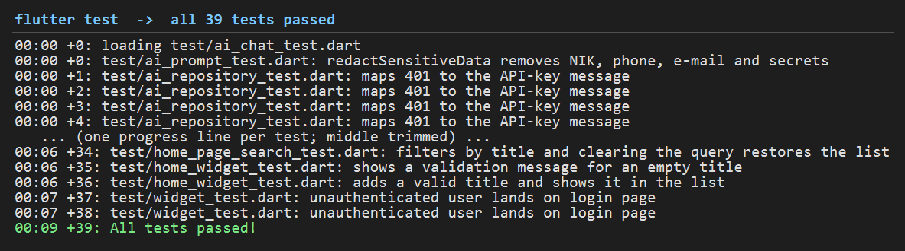
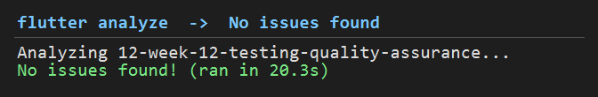
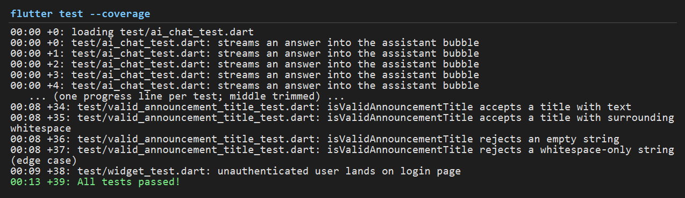
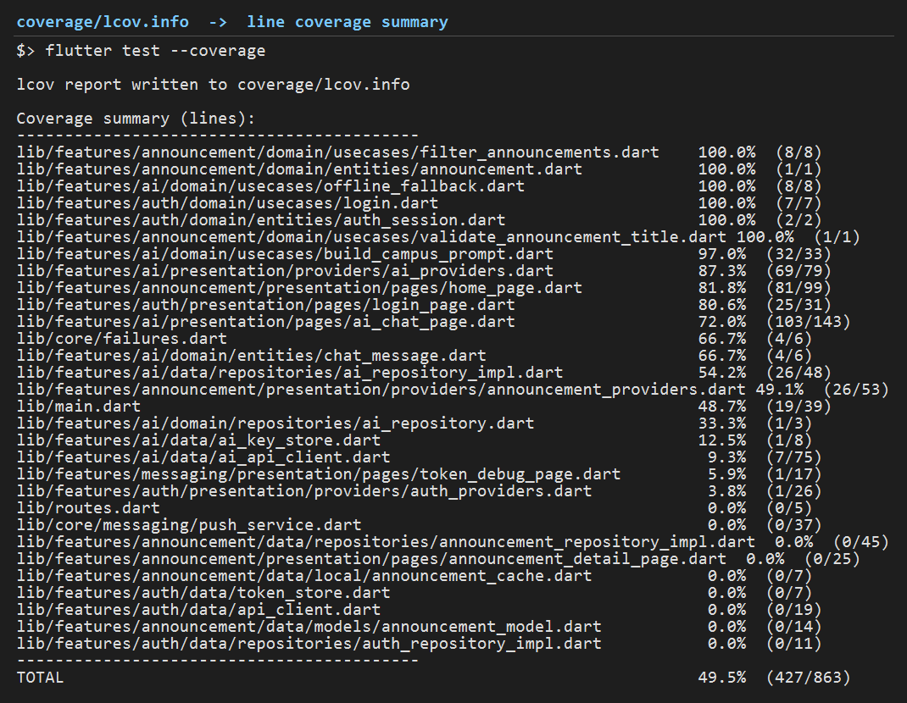
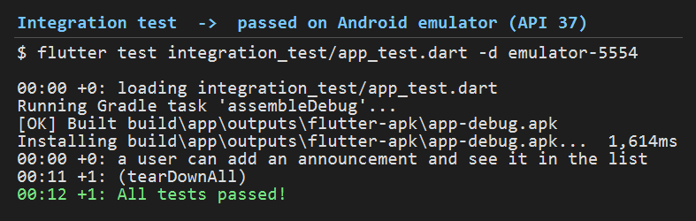
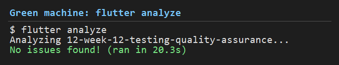
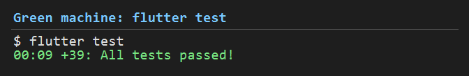
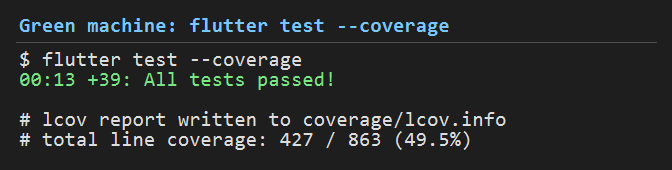
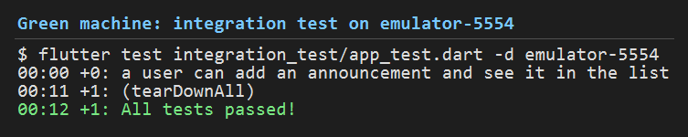
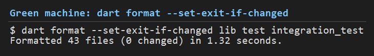

# Flutter Week 12 — Testing and Quality Assurance

Test work on top of the Week 11 project
[`11-week-11-performance-optimization`](../11-week-11-performance-optimization)
(the same `campus_notify` app from Weeks 7–11). This is a continuation of the
existing feature-first Clean Architecture project, not a new app.

Week 12 adds a **test suite** (unit → widget → integration), a **coverage
report**, and the small code changes that make the announcement feature
testable. The app behaviour is unchanged; what is new is the safety net that
catches regressions as the app grows.

## Table of Contents

1. [Feature, Stack](#feature-stack)
2. [Screenshots](#screenshots)
3. [Output Structure](#output-structure)
4. [Section 2: A Testing Strategy for Flutter Apps](#section-2-a-testing-strategy-for-flutter-apps)
5. [Section 3: Unit Tests and Edge Cases](#section-3-unit-tests-and-edge-cases)
6. [Section 4: Testing Async Code and Dependencies](#section-4-testing-async-code-and-dependencies)
7. [Section 5: Widget Testing](#section-5-widget-testing)
8. [Section 6: Integration and Regression Testing](#section-6-integration-and-regression-testing)
9. [Section 7: Lab — Build a Test Suite](#section-7-lab--build-a-test-suite)
10. [Section 8: Coverage, Assignment, and Reflection](#section-8-coverage-assignment-and-reflection)
11. [Green-Machine Evidence](#green-machine-evidence)
12. [References](#references)

---

## Feature, Stack

### The feature under test

The suite is built around the **announcement feature** — the same list + search

- detail flow that Week 11 optimised. That feature already had the two things
  the codelab needs:

* a **pure business rule** to unit-test (what counts as a valid title, and how
  the search filter matches), and
* a **repository contract** (`AnnouncementRepository`) that a test can replace
  with a fake.

Week 12 adds only what the lab requires, kept small and reviewable:

| Change                                                                                           | Why                                                                                             |
| ------------------------------------------------------------------------------------------------ | ----------------------------------------------------------------------------------------------- |
| `lib/.../usecases/validate_announcement_title.dart`                                              | the `isValidTaskTitle` analog: a pure rule the unit test targets                                |
| `addAnnouncement(...)` on the repository contract + impl + notifier                              | gives the widget and integration tests a real user action ("add a task and see it in the list") |
| `Key('announcement-title-field')`, `Key('save-announcement-button')`, `Key('announcement-list')` | stable finders for widget/integration tests (codelab §5.2)                                      |
| `integration_test/app_test.dart` + `integration_test` dependency                                 | the end-to-end flow test (codelab §6.1)                                                         |

Nothing in the existing screens, providers or routes was redesigned.

### Stack

| Layer          | Choice                                                          |
| -------------- | --------------------------------------------------------------- |
| UI             | Flutter 3.47.2 / Dart 3.13.2, Material 3                        |
| State / DI     | `flutter_riverpod ^3.4.3`                                       |
| Routing        | `go_router ^18.0.2`                                             |
| HTTP           | `dio ^5.11.1`                                                   |
| Secure storage | `flutter_secure_storage ^11.2.0`                                |
| Testing        | `flutter_test` (unit + widget), `integration_test` (end to end) |
| Coverage       | `flutter test --coverage` → `coverage/lcov.info`                |

## Screenshots

Every screenshot below is a **real capture of the terminal output** from the
commands run in this folder — not a mock-up. New in Week 12; no Week 11 image is
reused. The raw text of each run was rendered to a PNG; the procedure is
documented in [`screenshots/README.md`](screenshots/README.md).

| `flutter test` — 39 tests passed                        | `flutter analyze` — No issues found                           |
| ------------------------------------------------------- | ------------------------------------------------------------- |
|  |  |

| `flutter test --coverage` run                    | Coverage summary (`coverage/lcov.info`)                  |
| ------------------------------------------------ | -------------------------------------------------------- |
|  |  |

| Integration test — passed on the Android emulator               |
| --------------------------------------------------------------- |
|  |

The integration test runs the whole flow on a real Android emulator
(`emulator-5554`, API 37). The blocker that earlier prevented this is solved —
see [Section 6](#section-6-integration-and-regression-testing) for the exact
command and how the emulator was brought online.

---

## Section 2: A Testing Strategy for Flutter Apps

### 1. Choose the right kind of test

| Type            | What it checks                                    | Example in this project                              |
| --------------- | ------------------------------------------------- | ---------------------------------------------------- |
| **Unit**        | A function or object without rendering UI         | `isValidAnnouncementTitle`, `filterAnnouncements`    |
| **Widget**      | The output and interaction of one or more widgets | the add-announcement form shows a validation message |
| **Integration** | An end-to-end app flow on a device/emulator       | a user adds an announcement and sees it in the list  |

Unit tests are the fastest and easiest to maintain. Widget tests check the UI
without launching the app on a device. Integration tests cover a broader flow
but take longer to run and maintain.

### 2. Make code easier to test

Business logic mixed into widgets and network calls is hard to test in
isolation. This project separates responsibilities: widgets handle presentation
and interaction, while the repository handles the data source. The repository is
passed through a constructor or an abstraction (here, a Riverpod provider), so a
test can replace it with controlled data.

The suite targets behaviour that matters to users — the title rule, the search
rule, the add flow — rather than chasing full line coverage.

---

## Section 3: Unit Tests and Edge Cases

### 1. Test behaviour

The rule: an announcement title is valid when it contains non-whitespace text.

```dart
// lib/features/announcement/domain/usecases/validate_announcement_title.dart
bool isValidAnnouncementTitle(String value) => value.trim().isNotEmpty;
```

Test — `test/valid_announcement_title_test.dart`
(`flutter_test` is already available in Flutter projects):

```dart
import 'package:flutter_test/flutter_test.dart';
import 'package:campus_notify/features/announcement/domain/usecases/validate_announcement_title.dart';

void main() {
  group('isValidAnnouncementTitle', () {
    test('accepts a title with text', () {
      expect(isValidAnnouncementTitle('Learn Flutter'), isTrue);
    });

    test('rejects an empty string', () {
      expect(isValidAnnouncementTitle(''), isFalse);
    });

    test('rejects a whitespace-only string (edge case)', () {
      expect(isValidAnnouncementTitle('   '), isFalse);
      expect(isValidAnnouncementTitle('\t\n  '), isFalse);
    });
  });
}
```

### 2. Use Arrange, Act, Assert

- **Arrange** — prepare the required data and objects.
- **Act** — call the function or perform the action under test.
- **Assert** — check the result with `expect`.

The tests add the edge cases the codelab calls out: empty input,
whitespace-only input, and surrounding whitespace. They do not test only the
happy path.

---

## Section 4: Testing Async Code and Dependencies

### 1. Define a data-source contract

Unit tests must not rely on a live API. Network access, authentication and
server data change, which makes tests slow or inconsistent. The feature already
defines a small contract:

```dart
// lib/features/announcement/domain/repositories/announcement_repository.dart
abstract class AnnouncementRepository {
  Future<({List<Announcement> announcements, Failure? failure})>
      fetchAnnouncements();

  Future<({List<Announcement> announcements, Failure? failure})> fetchPage(int page);

  // Week 12: persist a user-created announcement.
  Future<({Announcement? announcement, Failure? failure})> addAnnouncement(String title);
}
```

### 2. Replace the API with a fake repository

A fake is a small implementation whose behaviour is controlled by the test. It
lets the test check both success and failure without an internet connection.

```dart
// test/task_repository_fake_test.dart
class FakeAnnouncementRepository implements AnnouncementRepository {
  FakeAnnouncementRepository({this.addResult, this.failOnAdd = false});

  final Announcement? addResult;
  final bool failOnAdd;
  final List<String> addCalls = [];

  @override
  Future<({Announcement? announcement, Failure? failure})> addAnnouncement(
    String title,
  ) async {
    addCalls.add(title);
    if (failOnAdd) {
      return (announcement: null, failure: const NetworkFailure('Backend is unavailable'));
    }
    return (announcement: addResult ?? Announcement(id: 'x1', title: title, preview: 'Created'), failure: null);
  }
  // fetchAnnouncements / fetchPage omitted for brevity ...
}
```

The tests inject the fake through `announcementRepositoryProvider` and check:

1. **success** — the created announcement is prepended and the call returns `true`;
2. **error** — the failure is surfaced and the list is left untouched (an error
   is never silently turned into an empty list);
3. **validation guard** — an invalid title never reaches the repository at all
   (`fake.addCalls` stays empty).

```dart
test('error: surfaces the failure and returns false', () async {
  final fake = FakeAnnouncementRepository(failOnAdd: true);
  final container = ProviderContainer(
    overrides: [announcementRepositoryProvider.overrideWithValue(fake)],
  );

  final ok = await container.read(announcementPageProvider.notifier)
      .addAnnouncement('Read the material');

  expect(ok, isFalse);
  expect(container.read(announcementPageProvider).error, 'Backend is unavailable');
});
```

---

## Section 5: Widget Testing

### 1. Build a widget and check its output

Widget tests run with `flutter_test`. `pumpWidget` renders the UI; finders check
what users can see. Only the repository is faked — the providers, the pure
domain rule and the widget wiring run for real, so these tests cover the
UI ↔ provider ↔ use case path end to end.

```dart
// test/home_widget_test.dart
testWidgets('shows the initial list and the add form', (tester) async {
  await tester.pumpWidget(_wrap(repository: _FakeRepository(), seed: fixture));
  await tester.pumpAndSettle();

  expect(find.text('Wireless mesh seminar'), findsOneWidget);
  expect(find.byKey(const Key('announcement-title-field')), findsOneWidget);
  expect(find.byKey(const Key('save-announcement-button')), findsOneWidget);
});
```

### 2. Test user interactions

To test a form or button, enter text with `enterText`, tap a control with `tap`,
then call `pumpAndSettle` to render the updated UI.

```dart
testWidgets('adds a valid title and shows it in the list', (tester) async {
  await tester.pumpWidget(_wrap(repository: _FakeRepository(), seed: fixture));
  await tester.pumpAndSettle();

  await tester.enterText(
    find.byKey(const Key('announcement-title-field')),
    'Read the material',
  );
  await tester.tap(find.byKey(const Key('save-announcement-button')));
  await tester.pumpAndSettle();

  expect(find.text('Read the material'), findsOneWidget);
});
```

A `Key` was added to each control because finding by visible text or widget type
is ambiguous once two `TextField`s exist on the same screen. The tests also
cover the important states the codelab lists: **invalid input** (empty title →
_"Title cannot be empty"_), **failure** (repository error → _"Could not save the
title"_, list unchanged) and the **success** action above. No fixed
`Future.delayed` is used to make a test pass; `pumpAndSettle` drives the frames.

---

## Section 6: Integration and Regression Testing

### 1. Run a flow on a device

Integration tests check multiple parts of the app working together. The
`integration_test` package is added under `dev_dependencies`:

```yaml
dev_dependencies:
  integration_test:
    sdk: flutter
```

The test lives in `integration_test/app_test.dart` and initialises its binding
first:

```dart
import 'package:integration_test/integration_test.dart';

void main() {
  IntegrationTestWidgetsFlutterBinding.ensureInitialized();

  testWidgets('a user can add an announcement and see it in the list', (tester) async {
    // Only the two data-layer plugins are replaced; the router, pages,
    // providers and the domain rule run for real.
    await tester.pumpWidget(/* ProviderScope(overrides: [...], child: CampusNotifyApp()) */);
    await tester.pump();
    await tester.pump(const Duration(milliseconds: 500));

    expect(find.text('Campus Notify'), findsOneWidget);

    await tester.enterText(
      find.byKey(const Key('announcement-title-field')),
      'Read the material',
    );
    await tester.tap(find.byKey(const Key('save-announcement-button')));
    await tester.pump();
    await tester.pump(const Duration(milliseconds: 500));

    expect(find.text('Read the material'), findsOneWidget);
  });
}
```

Run it on a connected emulator or device:

```bash
flutter test integration_test/app_test.dart -d emulator-5554
```

**Result — passed on the Android emulator.** The test builds, installs and runs
the full flow on the `Pixel_8` AVD (`emulator-5554`, Android 17 / API 37):

```text
00:00 +0: a user can add an announcement and see it in the list
00:11 +1: (tearDownAll)
00:12 +1: All tests passed!
```

The real output is captured in
[`screenshots/05-integration-test.png`](screenshots/05-integration-test.png).

**Getting the emulator online.** The AVD can start in an `offline` state that
never clears, which stops `flutter test` from seeing a device. A cold boot with
software rendering fixes it:

```bash
# Web is not supported for integration tests, and Windows needs the C++
# toolchain — use the Android emulator instead:
"$ANDROID_SDK/emulator/emulator.exe" -avd Pixel_8 \
  -no-snapshot -no-boot-anim -gpu swiftshader_indirect -no-audio
adb wait-for-device
# then, once `adb devices` shows `device`:
flutter test integration_test/app_test.dart -d emulator-5554
```

For reference, the targets that did **not** work in this environment:

| Command                                                  | Result                                                                                      |
| -------------------------------------------------------- | ------------------------------------------------------------------------------------------- |
| `flutter test integration_test/app_test.dart -d chrome`  | `Web devices are not supported for integration tests yet.`                                  |
| `flutter test integration_test/app_test.dart -d windows` | `Unable to find suitable Visual Studio toolchain.` (missing _Desktop development with C++_) |

### 2. Prevent regressions with a test

When you find and fix a bug, add a test that fails before the fix and passes
afterward. For example, the Week 9 bug in `filter_announcements.dart` — an AI-
generated call to `String.contains(q, caseSensitive: false)`, which does not
exist — is pinned by `test/search_filter_test.dart`, which failed to compile
before the fix and passes after it. Run the full suite with `flutter test`, not
just the test you have just added.

---

## Section 7: Lab — Build a Test Suite

Applied to the announcement feature, following the six steps:

1. **Describe the behaviour** — scenarios written down up front:
   - **happy path**: a title with text is valid;
   - **edge case**: a whitespace-only title is invalid;
   - **failure**: a repository error is surfaced, not swallowed.
2. **Test the logic** — `test/valid_announcement_title_test.dart`, grouped with
   `group('isValidAnnouncementTitle', ...)`.
3. **Test a dependency** — `test/task_repository_fake_test.dart` isolates data
   access behind `FakeAnnouncementRepository` for the success and error cases.
4. **Test the UI** — `test/home_widget_test.dart` checks the initial display,
   invalid input, a successful add, and the error state.
5. **Test the main flow** — `integration_test/app_test.dart` runs one flow
   across the app components (list → add → see it).
6. **Run the checks** — `flutter test`, `flutter analyze`, and
   `flutter test integration_test/app_test.dart -d <device_id>`. Failures are
   read from the output to identify the test and the unmet condition before
   moving on.

> When a test fails, read the output to identify the test and unmet condition.
> Check that the cause is not test order, shared data, or network dependence.

---

## Section 8: Coverage, Assignment, and Reflection

### 1. Treat coverage as a clue

```bash
flutter test --coverage
```

This writes `coverage/lcov.info`. Coverage shows which parts of the code ran
during tests; it does not guarantee that all behaviour was checked.

| Metric             | Value                  |
| ------------------ | ---------------------- |
| Lines covered      | **427 / 863 (49.5 %)** |
| Files instrumented | 30                     |

The layers the suite targets are well covered — the pure rules are at **100 %**
(`validate_announcement_title.dart`, `filter_announcements.dart`,
`login.dart`, `offline_fallback.dart`) and `home_page.dart` is ~81 %. The rest
of the total is the **plugin-backed data layer** (Dio + secure storage, the mock
repository, Firebase Cloud Messaging, `main.dart`) that needs a real device and
is deliberately replaced by fakes in tests. Full breakdown in
[`coverage/README.md`](coverage/README.md). The point is to review important
branches and edge cases, not to pad the percentage with assertion-free tests.

### 2. Assignment

| Requirement                                                                                    | Where                                                                                                                                                                                            |
| ---------------------------------------------------------------------------------------------- | ------------------------------------------------------------------------------------------------------------------------------------------------------------------------------------------------ |
| Unit + widget tests for a key feature, incl. success, invalid input, and an error              | `test/valid_announcement_title_test.dart`, `test/task_repository_fake_test.dart`, `test/home_widget_test.dart`                                                                                   |
| One integration test for the main flow                                                         | `integration_test/app_test.dart`; **passed** on the Android emulator (`emulator-5554`), see [Section 6](#section-6-integration-and-regression-testing) and `screenshots/05-integration-test.png` |
| Record scenarios, `flutter test` results, analysis results, unresolved findings in `README.md` | this file + [Green-Machine Evidence](#green-machine-evidence)                                                                                                                                    |
| Submit through the Git repository                                                              | the folder `12-week-12-testing-quality-assurance/`                                                                                                                                               |

### Reflection

**Which bug would have been easiest to miss without the tests you wrote?**
The validation guard. Without `test/home_widget_test.dart` and the
`addAnnouncement` fake test, it would be easy to ship a form that shows a
success message for an empty title, or that quietly sends a blank row to the
backend. The widget test ("shows a validation message for an empty title") and
the fake test ("invalid title never reaches the repository") make that exact
mistake fail loudly.

**Where did you need a fake, and how did it make the test more consistent?**
Every layer above the domain needed one: `FakeAnnouncementRepository` for the
notifier and widget tests, and the in-memory repository for the integration
test. The real `AnnouncementRepositoryImpl` sleeps 300 ms per "network" call and
writes to an in-memory cache, which would make ordering and timing part of the
test. The fake removes both: the tests are instant, deterministic, and can
produce a failure on demand (`failOnAdd: true`) that the real implementation
cannot easily be coaxed into.

**What did the widget and integration tests each tell you about your feature?**
The widget test proved the **UI wiring** — that the `Key`s exist, that typing and
tapping reach the notifier, and that both the validation message and the new row
appear where the user expects. The integration test proved the **composition** —
that the router boots the list for a signed-in user and that the add flow works
across real providers and pages, not just an isolated widget. The widget test
fails fast and localises a break; the integration test proves the parts still
fit together.

**What remains unresolved?**
Nothing blocking. The integration test now runs end to end on the Android
emulator (`emulator-5554`, API 37) and passes. The only environment friction was
the AVD sometimes coming up `offline`; the cold-boot command in
[Section 6](#section-6-integration-and-regression-testing) resolves it, so the
run is reproducible.

---

## Green-Machine Evidence

All commands were run in `12-week-12-testing-quality-assurance/` on the final
tree. Each block below is a **real capture of the command output** (rendered to
PNG the same way as the [Screenshots](#screenshots)).

### `flutter analyze`



### `flutter test`



Test groups (**39 tests**):

- `valid_announcement_title_test.dart` — 4 tests: the pure title rule (text,
  surrounding whitespace, empty, whitespace-only).
- `task_repository_fake_test.dart` — 3 tests: success, error, validation guard
  against a fake repository.
- `home_widget_test.dart` — 4 tests: initial list, invalid input, successful
  add, repository error.
- `home_page_search_test.dart` — 2 tests: empty state + search on the paginated
  list (updated for the new keys).
- `search_filter_test.dart` — 4 tests: the pure `filterAnnouncements` rule.
- `login_usecase_test.dart` — 3 tests: login success/failure mapping.
- `widget_test.dart` — 1 test: unauthenticated redirect to login.
- `ai_prompt_test.dart` — 8 tests: redaction, prompt assembly, validation,
  offline fallback.
- `ai_chat_test.dart` — 4 tests: streaming, fallback + retry, missing key, SSE
  timeout retry.
- `ai_repository_test.dart` — 6 tests: error mapping and model fallback.

### `flutter test --coverage`



Generates `coverage/lcov.info`; summary in
[Section 8](#section-8-coverage-assignment-and-reflection).

### `flutter test integration_test/app_test.dart -d emulator-5554`



Run on the `Pixel_8` Android emulator (Android 17 / API 37). Same run captured in
[`screenshots/05-integration-test.png`](screenshots/05-integration-test.png).

### `dart format --set-exit-if-changed lib test integration_test`



Formatting is clean; run it before committing to keep the diff minimal.

---

## References

- Week 12 Slides: Testing and Quality Assurance
- [Testing Flutter apps](https://docs.flutter.dev/testing)
- [Introduction to widget testing](https://docs.flutter.dev/testing/widget-tests)
- [Integration testing](https://docs.flutter.dev/testing/integration-tests)
- [Dart test package](https://pub.dev/packages/test)
- [`integration_test` package](https://pub.dev/packages/integration_test)
- [Riverpod: Testing](https://riverpod.dev/docs/essentials/testing)
