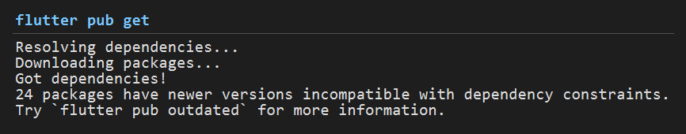
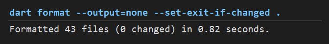
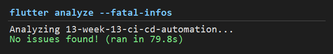
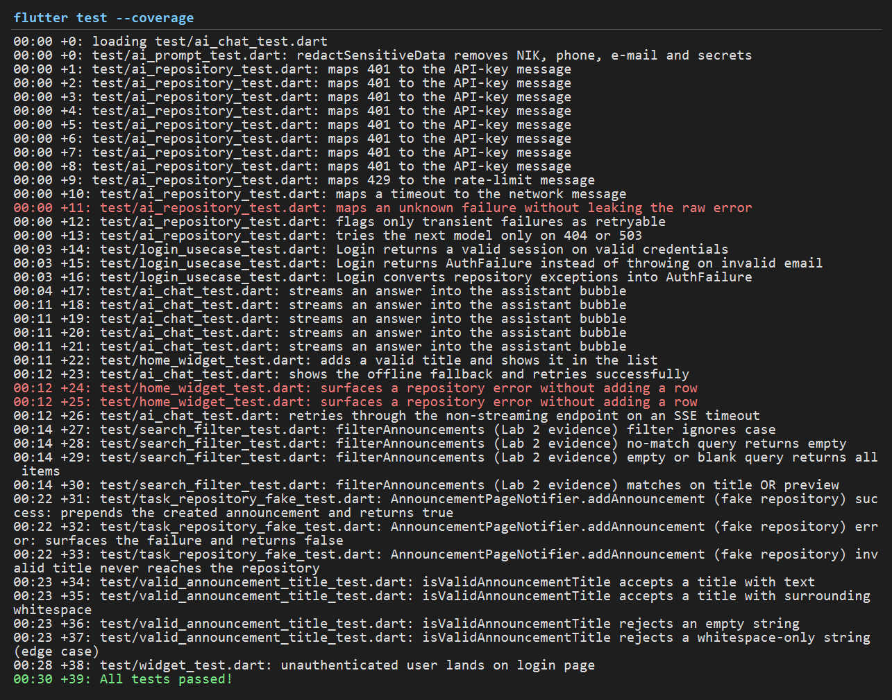
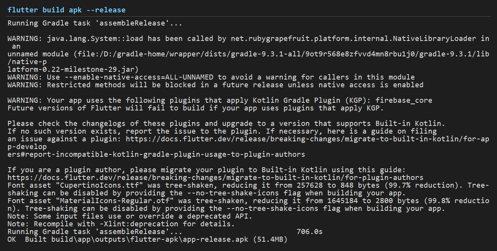
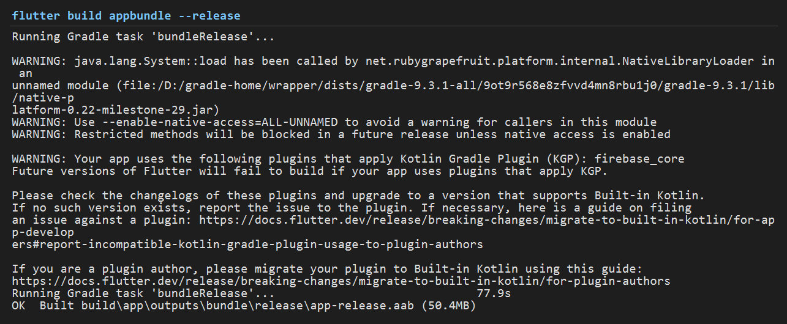
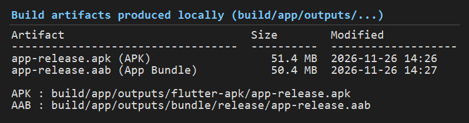
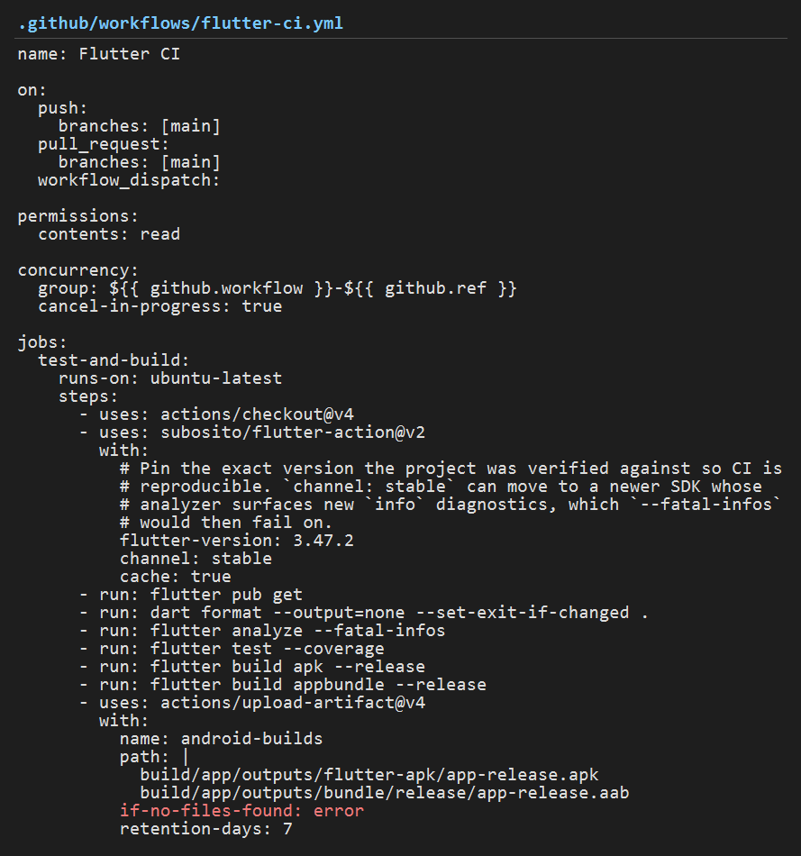
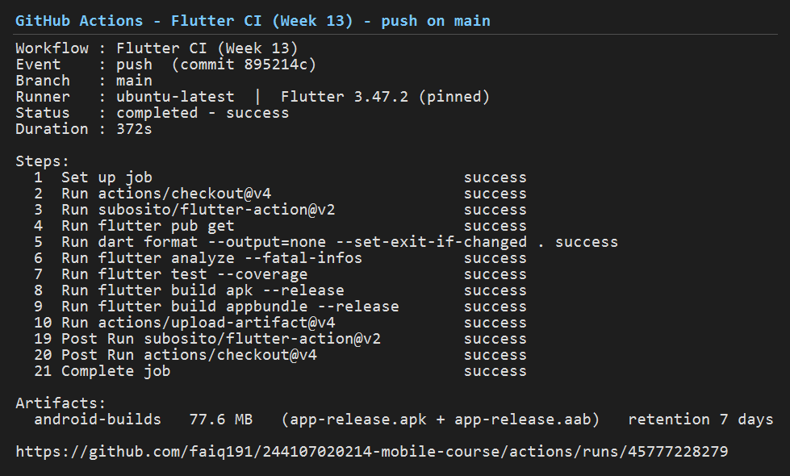
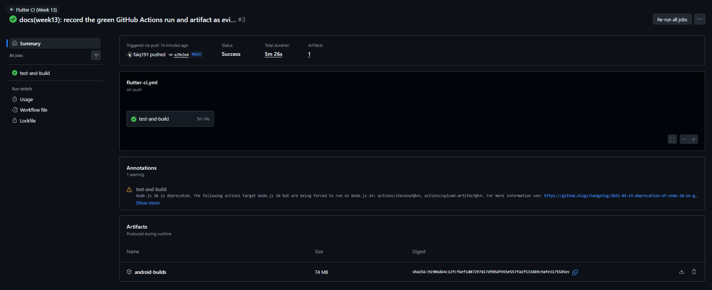

# Flutter Week 13 — CI/CD and Automation

CI/CD work on top of the Week 12 project
[`12-week-12-testing-quality-assurance`](../12-week-12-testing-quality-assurance)
(the same `campus_notify` app from Weeks 7–12). This is a continuation of the
existing feature-first Clean Architecture project, not a new app.

Week 13 turns the Week 12 test suite into an **automated pipeline**: a GitHub
Actions workflow that runs formatting, static analysis and tests, then builds
the Android **APK** and **AAB** and stores them as downloadable artifacts. The
app code is unchanged; what is new is the machine that runs the checks on every
push and pull request instead of relying on a human to remember them.

## Table of Contents

1. [Feature, Stack](#feature-stack)
2. [Screenshots](#screenshots)
3. [Output Structure](#output-structure)
4. [Section 2: Understanding CI/CD and the Workflow](#section-2-understanding-cicd-and-the-workflow)
5. [Section 3: Creating a Flutter CI Workflow](#section-3-creating-a-flutter-ci-workflow)
6. [Section 4: Building and Storing APK/AAB Files](#section-4-building-and-storing-apkaab-files)
7. [Section 5: Versions, Secrets, and Security](#section-5-versions-secrets-and-security)
8. [Section 6: Running and Evaluating the Pipeline](#section-6-running-and-evaluating-the-pipeline)
9. [Assignment](#assignment)
10. [Green-Machine Evidence](#green-machine-evidence)
11. [References](#references)

---

## Feature, Stack

### The app the pipeline builds

The workflow runs against the **`campus_notify`** app carried over from Week 12:
the announcement feature (list + search + add) with a unit/widget test suite and
one integration test. That project already had the two things the codelab needs:

* **commands that can fail** — `dart format --set-exit-if-changed`,
  `flutter analyze --fatal-infos`, `flutter test` — so the pipeline has a real
  pass/fail signal, and
* a **buildable Android target** — `flutter build apk` and `flutter build
  appbundle` produce artifacts worth storing.

Week 13 adds only the CI/CD layer, kept small and reviewable:

| Change | Why |
| --- | --- |
| `.github/workflows/flutter-ci.yml` (in this folder) | the codelab's workflow file, in the required folder layout |
| `.github/workflows/flutter-ci.yml` (repo root) | GitHub only runs workflows from the repo root, so this runnable copy targets this folder via `working-directory` |
| `screenshots/` | real captures of every pipeline command run locally |
| `README.md` (this file) | records the design, the next version, and the remaining security risks |

Nothing in the app's screens, providers or tests was redesigned.

> **Why two workflow files?** The codelab asks for
> `13-week-13-ci-cd-automation/.github/workflows/flutter-ci.yml` so the evidence
> travels with the week. But GitHub **ignores** workflow files that are not at
> the repository root's `.github/workflows/`, so a file inside the week folder
> would never run. The root copy is the one Actions actually executes; the two
> are identical except for `working-directory`.

### Stack

| Layer | Choice |
| --- | --- |
| UI | Flutter 3.47.2 / Dart 3.13.2, Material 3 |
| State / DI | `flutter_riverpod ^3.4.3` |
| Routing | `go_router ^18.0.2` |
| HTTP | `dio ^5.11.1` |
| Secure storage | `flutter_secure_storage ^11.2.0` |
| Tests | `flutter_test` (unit + widget), `integration_test` (end to end) |
| CI/CD | GitHub Actions — `subosito/flutter-action@v2`, `actions/upload-artifact@v4` |
| Build artifacts | `app-release.apk`, `app-release.aab` |

## Screenshots

Every screenshot below is a **real capture of the output** from the commands run
in this folder and from GitHub Actions — not a mock-up. The local command output
was rendered to a PNG, and the Actions page was captured directly from the
browser.

| `flutter pub get` | `dart format` — 0 changed |
| --- | --- |
|  |  |

| `flutter analyze --fatal-infos` — No issues found | `flutter test --coverage` — 39 tests passed |
| --- | --- |
|  |  |

| `flutter build apk --release` | `flutter build appbundle --release` |
| --- | --- |
|  |  |

| Real artifacts on disk | The workflow definition |
| --- | --- |
|  |  |

| The pipeline run on GitHub Actions — green on `main` |
| --- |
|  |

| The real Actions page in the browser (tab *Actions* → run on `main`) |
| --- |
|  |

The browser capture above (run `#3`, commit `e2fe2e4`) shows the **Status:
Success**, the `test-and-build` job passing, and the `android-builds` artifact
(**74 MB**) produced during the run. `09-github-actions-run.png` is the same run
summarised step-by-step from the GitHub API
([run #45778430235](https://github.com/faiq191/244107020214-mobile-course/actions/runs/45778430235)).

---

## Section 2: Understanding CI/CD and the Workflow

### 1. CI and CD

**Continuous integration (CI)** runs automated checks when changes are proposed
or pushed. **Continuous delivery/deployment (CD)** automates release preparation
or delivery. A good pipeline makes important steps repeatable and its results
reviewable.

In this project the flow from a commit to an artifact is:

```text
  commit / pull request
          │
          ▼
  ┌─────────────────────────────────────────────┐
  │  GitHub Actions runner (ubuntu-latest)       │
  │                                              │
  │   1. actions/checkout@v4   ← fetch source    │
  │   2. subosito/flutter-action@v2 ← set up SDK │
  │   3. flutter pub get                         │
  │   4. dart format --set-exit-if-changed .     │
  │   5. flutter analyze --fatal-infos           │
  │   6. flutter test --coverage                 │
  │   7. flutter build apk --release             │
  │   8. flutter build appbundle --release       │
  │   9. actions/upload-artifact@v4              │
  └─────────────────────────────────────────────┘
          │
          ▼
  android-builds artifact  (APK + AAB, kept 7 days)
```

* A commit or pull request **triggers** the workflow.
* A **runner** checks out the source and sets up Flutter.
* **Formatting, static analysis, and tests** run; any failure stops the job.
* If checks pass, the **app is built** and its **artifacts are stored**.

### 2. Events and permissions

| Event | When it fires | Why it is here |
| --- | --- | --- |
| `pull_request` | a PR targets `main` | check changes **before** merging |
| `push` | a commit lands on `main` | check the branch after merging |
| `workflow_dispatch` | a human clicks *Run workflow* | re-run on demand for evidence |

The job grants only the minimum permissions required:

```yaml
permissions:
  contents: read
```

A CI job that only reads code needs only `contents: read`; write access is not
granted without a clear requirement. Note also that **pull requests from forks
do not receive repository GitHub Secrets**, which is why the pipeline must be
able to run without any secret — and it is: every step above uses only public
tooling.

---

## Section 3: Creating a Flutter CI Workflow

### 1. The workflow file

At the project root of this folder:
[`.github/workflows/flutter-ci.yml`](.github/workflows/flutter-ci.yml).

```yaml
name: Flutter CI

on:
  push:
    branches: [main]
  pull_request:
    branches: [main]
  workflow_dispatch:

permissions:
  contents: read

concurrency:
  group: ${{ github.workflow }}-${{ github.ref }}
  cancel-in-progress: true

jobs:
  test-and-build:
    runs-on: ubuntu-latest
    steps:
      - uses: actions/checkout@v4
      - uses: subosito/flutter-action@v2
        with:
          flutter-version: 3.47.2   # pinned — see note below
          channel: stable
          cache: true
      - run: flutter pub get
      - run: dart format --output=none --set-exit-if-changed .
      - run: flutter analyze --fatal-infos
      - run: flutter test --coverage
```

`concurrency` with `cancel-in-progress: true` cancels a superseded run when a
newer commit arrives on the same ref, so runners are not spent on stale commits.

> **Why pin `flutter-version`?** The first push used the bare `channel: stable`,
> which on the runner resolved to a **newer** SDK (Flutter 3.50.1 / Dart 3.14.0)
> than the one this project was verified against (Flutter 3.47.2 / Dart 3.13.2).
> The newer analyzer surfaced new `info` diagnostics, and `--fatal-infos` then
> failed the job even though the same tree passed locally. Pinning the version
> the project and its `pubspec.lock` were built with makes the pipeline
> reproducible — the point the codelab's versioning section makes. Both the
> repo-root workflow and the copy in this folder carry the pin.

### 2. Check locally first

Before pushing, the **same three commands** were run in this folder. The real
output is captured in the screenshots above:

```text
Formatted 43 files (0 changed) in 0.82 seconds.   # dart format --set-exit-if-changed .
No issues found! (ran in 79.8s)                    # flutter analyze --fatal-infos
00:30 +39: All tests passed!                       # flutter test --coverage
```

Failures are fixed, not silenced — the checks are never removed to make the
workflow green.

---

## Section 4: Building and Storing APK/AAB Files

### 1. Build steps

After the tests pass, these steps build and store the artifacts (same job, so
they share the checked-out source and the installed Flutter SDK):

```yaml
      - run: flutter build apk --release
      - run: flutter build appbundle --release
      - uses: actions/upload-artifact@v4
        with:
          name: android-builds
          path: |
            build/app/outputs/flutter-apk/app-release.apk
            build/app/outputs/bundle/release/app-release.aab
          if-no-files-found: error
          retention-days: 7
```

| Setting | Meaning |
| --- | --- |
| `name: android-builds` | the artifact bundle name shown on the Actions tab |
| `path:` (two files) | **both** the APK and the AAB are stored together |
| `if-no-files-found: error` | fail loudly if a build produced nothing (no silent green) |
| `retention-days: 7` | artifacts expire after a week to limit storage |

The same two builds were run **locally** here and produced real files:

| Artifact | Format | Size | Use |
| --- | --- | --- | --- |
| `app-release.apk` | APK | **51.4 MB** | convenient for installation and internal testing |
| `app-release.aab` | App Bundle | **50.4 MB** | the distribution format Google Play workflows use |

Download artifacts from the workflow run on the **Actions** tab.

> A successful build does **not** automatically mean the app is ready to
> publish. Signing, app configuration, permissions, and target-device testing
> still need review. This workflow does **not** upload anything to the Play
> Store.

---

## Section 5: Versions, Secrets, and Security

### 1. Versioning

In `pubspec.yaml`, the version is:

```yaml
version: 1.0.0+1
```

This means **app version `1.0.0`** and **build number `1`**. Semantic
versioning:

| Bump | When |
| --- | --- |
| **major** (`2.0.0`) | incompatible changes |
| **minor** (`1.1.0`) | backward-compatible features |
| **patch** (`1.0.1`) | fixes |

**Next version for this project: `1.1.0+2`.** Because the add-announcement flow
and its tests were added since `1.0.0+1` without breaking the public behaviour,
the minor and the build number both move. The build number must be incremented
for each new upload.

A git tag such as `v1.1.0` connects source, pipeline logs, and artifacts. Make
sure the tag points to a commit that **passed** the checks before tagging.

### 2. Secrets and configuration

| Do | Don't |
| --- | --- |
| Store private tokens, passwords, and signing material in **GitHub Actions Secrets** | put them in the repository or in `pubspec.yaml` |
| Treat an API URL and environment name as **public configuration** | treat them as credentials |
| Inject sensitive signing material only into a **restricted release workflow** | expose a production keystore to pull-request workflows |

Two rules the codelab stresses:

* **Never** print secrets to logs or send them to untrusted processes.
* A value passed with **`--dart-define` and compiled into an app is not a
  secret** — it can be extracted from the client binary.

**Security risks that remain in this project** (documented, not solved):

1. `android/app/google-services.json` is committed. It contains a (public)
   Firebase Android API key and project identifiers, not a server secret, but it
   is still configuration that deserves review.
2. This workflow does not sign releases. A signed release needs a keystore,
   which must live in GitHub Secrets and only be wired into a separate,
   restricted release job — never into the PR job.
3. `--dart-define` values (e.g. an AI API base URL) are visible to anyone who
   inspects the APK; anything truly secret must be brokered by a backend.

---

## Section 6: Running and Evaluating the Pipeline

### 1. Run the workflow

1. Commit the workflow file and push it to GitHub.
2. Open the **Actions** tab and select the relevant run.
3. Review each step. Confirm that a **test failure makes the job fail** — the
   gate is only real if a red test turns the run red.
4. Download the `android-builds` artifact and record the **commit** that
   produced it.

```bash
git add 13-week-13-ci-cd-automation .github/workflows/flutter-ci.yml
git commit -m "ci(week13): add Flutter CI, build APK/AAB and upload artifacts"
git push origin main
# then: GitHub → Actions → "Flutter CI (Week 13)" → latest run → android-builds
```

**Result — the pipeline is green.** Run
[#45778430235](https://github.com/faiq191/244107020214-mobile-course/actions/runs/45778430235)
(`push` of commit `e2fe2e4`) completed with **all 10 steps successful** and the
`android-builds` artifact (APK + AAB, 74 MB) uploaded. The browser capture of the
run page is in [`screenshots/10-actions-run.png`](screenshots/10-actions-run.png).

The first push (with the un-pinned `channel: stable`) **failed** at
`flutter analyze --fatal-infos`; pinning Flutter 3.47.2 turned it green. That is
the pipeline doing its job: it caught an environment mismatch a human would have
missed.

### 2. How to run it locally (what was captured here)

Every step of the pipeline was executed in this folder first; the real output is
in [`screenshots/`](screenshots):

```bash
flutter pub get
dart format --output=none --set-exit-if-changed .
flutter analyze --fatal-infos
flutter test --coverage
flutter build apk --release
flutter build appbundle --release
```

### Reflection

**What problem was detected automatically before changes were merged?**
Formatting drift and analyzer findings. `dart format --set-exit-if-changed .`
and `flutter analyze --fatal-infos` catch the two easiest regressions to miss on
review — a file someone forgot to format and a new lint or type warning — plus
any unit/widget test that broke, before a reviewer has to look.

**What information would help you investigate a failed build?**
The exact **failing step** and its log (the workflow names each step), the
**commit SHA** and branch, the full command output around the failure (e.g. the
unmet `expect`), whether the same commands pass **locally** on that commit, and
the runner environment (Flutter channel, OS image). Pinning `channel: stable` and
recording the tag means the environment is reproducible.

**What still needs approval or manual review before a release?**
Signing and keystore handling, the Play Store listing and store configuration,
runtime permissions, and real-device testing on target phones. A green CI run
proves the code formats, analyzes, tests and builds — it does **not** approve a
release.

---

## Assignment

| Requirement | Where |
| --- | --- |
| CI workflow with formatting, analysis, and tests | `.github/workflows/flutter-ci.yml` (this folder) + runnable root copy `.github/workflows/flutter-ci.yml` |
| Build an APK **and** AAB, store both as artifacts | `flutter build apk/appbundle --release` + `actions/upload-artifact@v4` (`android-builds`); local proof in `screenshots/05`, `06`, `07` |
| Run the workflow on a PR or push to `main`; include evidence of result and commit | run [#45778430235](https://github.com/faiq191/244107020214-mobile-course/actions/runs/45778430235) — **success** on `push` of `e2fe2e4`; browser capture `screenshots/10-actions-run.png` + step summary `screenshots/09-github-actions-run.png`; local command evidence in [`screenshots/`](screenshots) |
| Document the next version, checks performed, remaining security risks | [Section 5](#section-5-versions-secrets-and-security) — next version `1.1.0+2`, checks listed, three risks recorded |
| Submit through the Git repository | the folder `13-week-13-ci-cd-automation/` |

---

## Green-Machine Evidence

All commands were run in `13-week-13-ci-cd-automation/` on the final tree. Each
image is a **real capture of the command output** (rendered to PNG the same way
as the [Screenshots](#screenshots)).

### `flutter pub get`


### `dart format --output=none --set-exit-if-changed .`


### `flutter analyze --fatal-infos`


### `flutter test --coverage`


Test groups (**39 tests**): the pure rules
(`valid_announcement_title_test.dart`, `search_filter_test.dart`,
`login_usecase_test.dart`), the fake-repository tests
(`task_repository_fake_test.dart`), the widget tests
(`home_widget_test.dart`, `home_page_search_test.dart`, `widget_test.dart`) and
the AI tests (`ai_prompt_test.dart`, `ai_chat_test.dart`,
`ai_repository_test.dart`). Coverage summary in
[`coverage/README.md`](coverage/README.md) — **427 / 863 lines (49.5 %)**.

### `flutter build apk --release`


### `flutter build appbundle --release`


### The two artifacts


### Continuous integration

The same commands run in the GitHub Actions job
[`.github/workflows/flutter-ci.yml`](../.github/workflows/flutter-ci.yml)
(`Flutter CI (Week 13)`). The workflow pins Flutter **3.47.2** so the runner
matches the version above; the earlier un-pinned run failed at
`flutter analyze --fatal-infos` because `channel: stable` had moved to a newer
SDK — see [Section 3](#section-3-creating-a-flutter-ci-workflow).


The same run as it appears in the browser on the **Actions** tab — green status
and the `android-builds` artifact:


Run [#45778430235](https://github.com/faiq191/244107020214-mobile-course/actions/runs/45778430235)
(`push` of `e2fe2e4`): 10/10 steps success, `android-builds` artifact uploaded (74 MB).

---

## References

- Week 13 Slides: CI/CD and Automation
- [GitHub Actions documentation](https://docs.github.com/actions)
- [Continuous delivery with Flutter](https://docs.flutter.dev/deployment/cd)
- [Build and release an Android app](https://docs.flutter.dev/deployment/android)
- [Using secrets in GitHub Actions](https://docs.github.com/actions/security-guides/using-secrets-in-github-actions)
- [Semantic Versioning](https://semver.org/)
